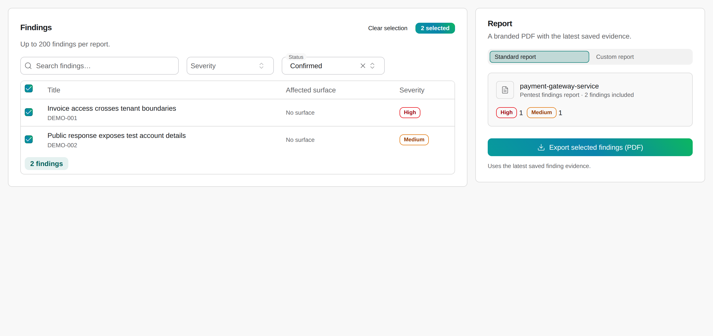

Cyber cung cấp hai loại báo cáo: bản xuất các issue bạn chọn, dùng cho ticket, buổi review bản sửa hoặc gửi khách hàng, và báo cáo đầy đủ mà mỗi [lượt pentest](/vi/guide/security/security-testing) viết ra khi kết thúc. Việc xuất không bao giờ bắt đầu một lượt quét mới, nên bạn có thể xuất bao nhiêu lần tùy ý.

## Điều kiện tiên quyết

- Quyền xem ứng dụng Cyber. Viewer có thể xuất issue và tải báo cáo lượt chạy.
- Để xuất: ứng dụng có ít nhất một issue. Xem [Phân loại issue bảo mật](/vi/guide/security/cyber-findings).
- Để tạo báo cáo tùy chỉnh: quyền truy cập Chat trong workspace.

## Chọn loại báo cáo

| Báo cáo | Nội dung | Lấy ở đâu |
| --- | --- | --- |
| **CSV** | Mỗi hàng là một issue khớp với bộ lọc hoặc lựa chọn của bạn | **Export** trên danh sách **Issues** |
| **PDF report** | Một tệp PDF mang thương hiệu gồm các issue bạn xuất: trang bìa, bản tóm tắt theo mức độ nghiêm trọng, phạm vi xuất, mục lục, rồi mỗi issue một phần kèm chi tiết và bằng chứng | **Export** trên danh sách **Issues** |
| **Custom report…** | Các issue bạn xuất, do CloudThinker viết theo yêu cầu của bạn, có thể theo cấu trúc và văn phong của một báo cáo tham chiếu | **Export** trên danh sách **Issues**, gửi trong Chat |
| Báo cáo lượt chạy | Toàn bộ đánh giá của một lượt chạy, kể cả những gì lượt chạy không kiểm thử được | Tab **Report** của lượt chạy |

## Xuất issue

<Steps>
  <Step title="Mở Issues">
    Mở ứng dụng từ **Pentest apps** và nhấn tab **Issues** của ứng dụng. Bạn cũng có thể dùng tab **Issues** ở đầu Cyber với bộ lọc **Target** đặt cho một ứng dụng.
  </Step>
  <Step title="Chọn issue">
    Lọc danh sách, hoặc đánh dấu các hàng bạn muốn. Các hàng đã đánh dấu vẫn được chọn khi bạn chuyển trang, và bị bỏ chọn khi bạn đổi bộ lọc.
  </Step>
  <Step title="Xuất">
    Nhấn **Export** ở bên phải thanh công cụ. Trong **Issues**, chọn **All matching filters** hoặc **Selected rows**, rồi chọn **CSV** hoặc **PDF report**.

    **Trạng thái thành công:** bạn thấy **Issues exported as CSV** hoặc **PDF report ready**, và tệp được tải xuống.
  </Step>
</Steps>

<Frame>
  
</Frame>

**PDF report** và **Custom report…** nhận tối đa 200 issue từ một ứng dụng pentest. Trên danh sách **Issues** toàn Cyber, hãy lọc theo một ứng dụng hoặc chọn các hàng từ một ứng dụng trước; menu sẽ cho biết lý do khi các tùy chọn này bị tắt. Lần xuất thất bại vẫn giữ lựa chọn của bạn, nên bạn có thể thử lại.

## Viết báo cáo tùy chỉnh theo định dạng của bạn

Dùng báo cáo tùy chỉnh khi issue phải khớp với một mẫu mà nhóm hoặc khách hàng của bạn đang dùng, chẳng hạn định dạng rà soát bảo mật nội bộ.

<Steps>
  <Step title="Mở Custom report">
    Trên **Issues**, nhấn **Export**, chọn phạm vi, rồi nhấn **Custom report…**.
  </Step>
  <Step title="Viết yêu cầu">
    Trong **Brief**, nêu báo cáo cần làm gì, ví dụ:

    ```text
    Write an executive summary for leadership, then group issues by risk with clear fix steps.
    ```

    Để sao chép cấu trúc và văn phong của một mẫu, nhấn **Upload a reference report** và chọn tệp PDF hoặc DOCX tối đa 5 MB.
  </Step>
  <Step title="Tạo báo cáo">
    Nhấn **Generate report**.

    **Trạng thái thành công:** một cuộc chat mở ra với các issue của bạn và báo cáo tham chiếu (nếu có) đã được nạp, và CloudThinker viết báo cáo ở đó. Hỏi tiếp trong cùng cuộc chat để chỉnh sửa báo cáo.
  </Step>
</Steps>

CloudThinker sao chép cấu trúc và văn phong của báo cáo tham chiếu, không sao chép dữ kiện. Các phát hiện ví dụ trong báo cáo tham chiếu không bao giờ xuất hiện như kết quả của bạn.

## Đặt cách các lượt chạy sau viết báo cáo

Cài đặt báo cáo thuộc về ứng dụng, không thuộc về workspace. Mỗi lượt chạy viết báo cáo theo cài đặt đã lưu lúc lượt chạy bắt đầu, nên hãy thay đổi trước lượt chạy tiếp theo.

<Steps>
  <Step title="Mở mục Reports">
    Mở tab **Settings** của ứng dụng và đến **Reports**.
  </Step>
  <Step title="Chọn văn phong và định dạng">
    Trong **Style**, chọn **Standard** hoặc **Custom**. Với Custom, viết yêu cầu và có thể thêm báo cáo tham chiếu (PDF hoặc DOCX, tối đa 5 MB). Trong **Format**, chọn **PDF** hoặc **DOCX**. **Delivery** liên kết đến cài đặt thông báo của bạn.
  </Step>
  <Step title="Lưu">
    Nhấn **Save changes** trên thanh xuất hiện.

    **Trạng thái thành công:** thanh đóng lại. Lượt chạy tiếp theo dùng các cài đặt này. Các lượt chạy đã bắt đầu và các bản xuất từ **Issues** không bị ảnh hưởng.
  </Step>
</Steps>

## Tải báo cáo lượt chạy

<Steps>
  <Step title="Mở báo cáo lượt chạy">
    Mở tab **Runs** của ứng dụng, chọn lượt chạy và nhấn tab **Report** của lượt chạy đó.
  </Step>
  <Step title="Tải xuống">
    Nhấn **Download report**. Nhấn **Expand preview** để đọc ở khổ lớn hơn trước.

    **Trạng thái thành công:** tệp được tải xuống theo định dạng đã chọn trong cài đặt báo cáo của ứng dụng lúc lượt chạy đó bắt đầu.
  </Step>
</Steps>

Hãy đọc phần giới hạn về phạm vi kiểm thử và xác thực trong báo cáo trước khi chia sẻ kết luận. Để có kết luận mới sau khi sửa, hãy chạy một lượt pentest khác.

## Báo cáo gồm những gì

- **Bằng chứng:** request, response và ảnh chụp màn hình đã ghi lại trong lượt chạy. Việc xuất không bao giờ thu thập bằng chứng mới.
- **Che thông tin:** mật khẩu, token, cookie và key được thay bằng placeholder. Dùng thông tin đăng nhập kiểm thử của riêng bạn để phát lại một request.
- **Giới hạn:** báo cáo lượt chạy nêu những gì lượt chạy không kiểm thử được, chẳng hạn các khu vực nằm sau một lần đăng nhập thất bại, và khi thiếu một ảnh chụp màn hình cần thiết.
- **Luồng bằng chứng:** hiển thị trên trang issue và trong các issue được sao chép, nhưng không có trong PDF report.

## Khắc phục sự cố

Để xem mọi vấn đề của Cyber ở một nơi, xem [Khắc phục sự cố Cyber](/vi/guide/security/cyber-troubleshooting).

<AccordionGroup>
  <Accordion title="PDF report hoặc Custom report bị tắt">
    Hai tùy chọn này cần tối đa 200 issue từ một ứng dụng pentest. Menu cho biết lý do, ví dụ **Select issues from one pentest app.** Thu hẹp bộ lọc, lọc theo một ứng dụng, hoặc chọn ít hàng hơn.
  </Accordion>
  <Accordion title="Không chọn được Custom report">
    Báo cáo tùy chỉnh bắt đầu một cuộc chat, nên cần quyền truy cập Chat. Hãy đề nghị admin của workspace cấp quyền này.
  </Accordion>
  <Accordion title="Xuất thất bại">
    Bạn thấy **Could not export issues.** Lựa chọn của bạn vẫn được giữ, nên hãy kiểm tra lại và xuất lần nữa.
  </Accordion>
  <Accordion title="Một lượt chạy hiển thị No report yet">
    Báo cáo được viết khi lượt chạy kết thúc. Lượt chạy thất bại và kết thúc trước khi viết báo cáo cũng hiển thị cùng thông báo. Lượt chạy bị dừng không tạo báo cáo và hiển thị **Run stopped** thay vào đó. Bắt đầu lượt chạy mới để có báo cáo.
  </Accordion>
  <Accordion title="Cài đặt báo cáo mới không thay đổi báo cáo cũ">
    Mỗi lượt chạy giữ cài đặt báo cáo từ lúc bắt đầu. Bắt đầu lượt chạy mới để có báo cáo theo văn phong mới.
  </Accordion>
</AccordionGroup>

## Bước tiếp theo

<CardGroup cols={2}>
  <Card title="Phân loại issue bảo mật" icon="list-check" href="/vi/guide/security/cyber-findings">
    Kiểm tra bằng chứng của từng issue trước khi chia sẻ
  </Card>
  <Card title="Chạy kiểm thử bảo mật" icon="crosshairs" href="/vi/guide/security/security-testing">
    Chạy lại để xác minh bản sửa và có báo cáo mới
  </Card>
</CardGroup>
