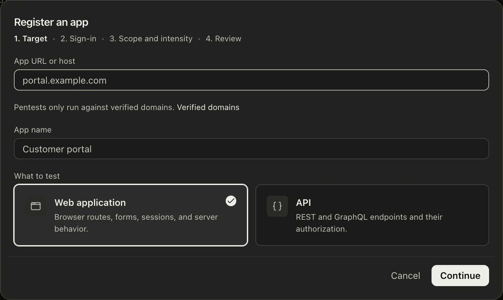
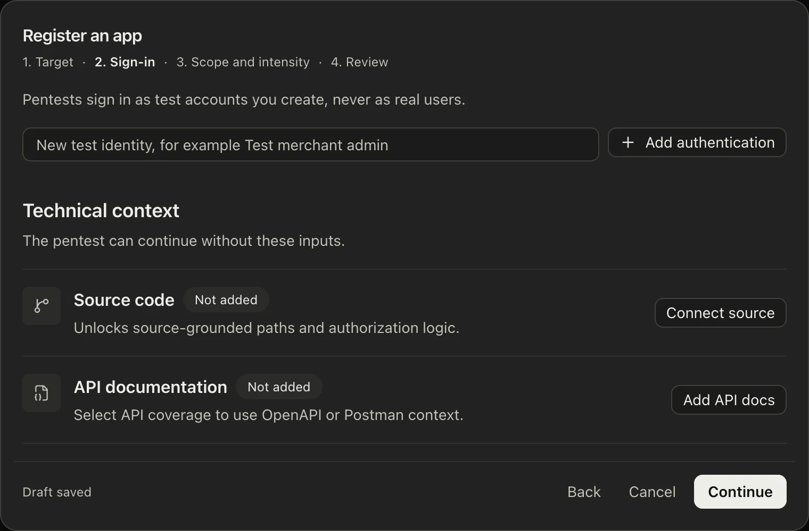
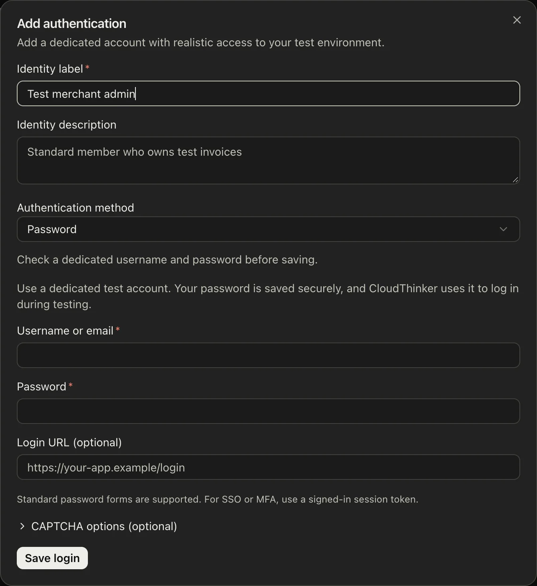
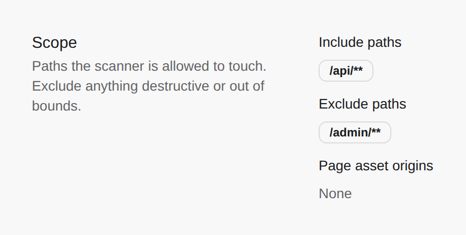
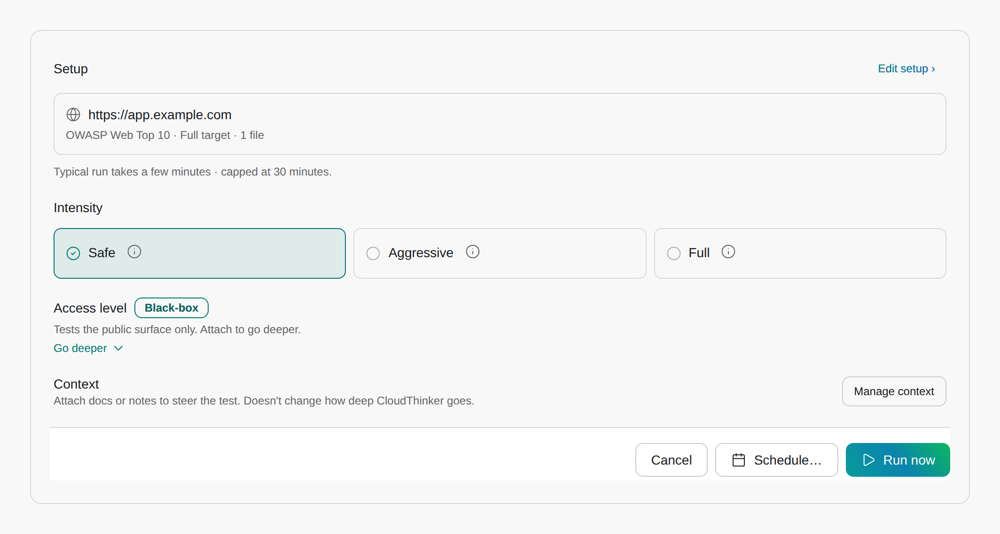
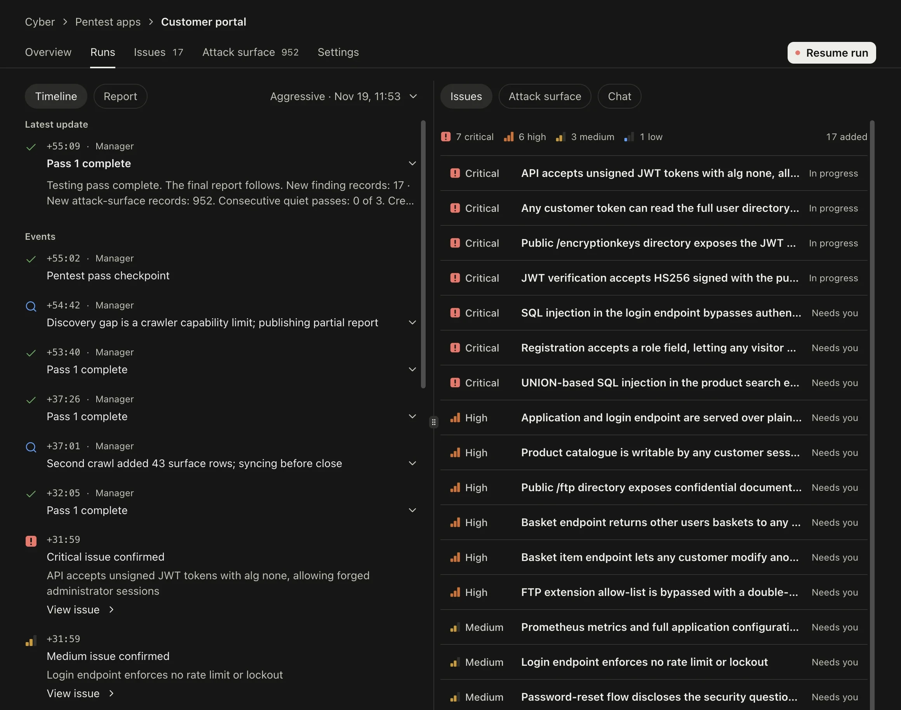

Lượt pentest là một lượt quét DAST trên một ứng dụng đang chạy của bạn: CloudThinker kiểm thử ứng dụng trong giới hạn bạn đặt ra và ghi lại bằng chứng request và response cho mọi vấn đề được xác nhận. Trang này trình bày mọi tùy chọn thiết lập; để chạy lần đầu với thiết lập tối thiểu, hãy dùng [Bắt đầu nhanh với Cyber](/vi/guide/security/cyber-quickstart).

## Điều kiện tiên quyết

- Một ứng dụng bạn được phép kiểm thử, truy cập được qua URL tên miền. Dùng môi trường staging cho mọi cường độ cao hơn **Safe**.
- Quyền truy cập bản ghi DNS của tên miền, và quyền admin workspace để xác minh tên miền.
- Credit cho lượt chạy. Lượt chạy nào cũng tốn credit, và Deep dive cùng Fortress tốn nhiều nhất. Xem [Mức sử dụng](/vi/guide/billing/usage).
- Tùy chọn: tài khoản thử nghiệm riêng, OpenAPI spec hoặc Postman collection, và [kết nối Git](/vi/guide/connections/github) để kiểm thử white-box.

## Đăng ký ứng dụng

<Steps>
  <Step title="Đặt mục tiêu">
    Mở **Cyber**, vào **Pentest apps** và nhấn **Register an app**. Hộp thoại có bốn bước: **Target**, **Sign-in**, **Scope and intensity** và **Review**. Ở bước **Target**, nhập **App URL or host** và **App name**, rồi chọn **Web application** hoặc **API** trong **What to test**. Nhấn **Continue**.

    Lựa chọn này quyết định các nhóm OWASP mà báo cáo độ bao phủ sẽ đo. Bạn không thể kết hợp hai loại hay đổi về sau; hãy tạo ứng dụng thứ hai để kiểm thử cùng host dưới dạng API.

    <Frame>
      
    </Frame>
  </Step>
  <Step title="Xác minh tên miền">
    Trong **Target ownership**, nhấn **Create DNS proof**. Thêm **DNS record name** và **TXT value** được hiển thị dưới dạng bản ghi TXT tại nhà cung cấp DNS, rồi nhấn **Check again**. Nếu nhà cung cấp tự thêm tên zone, hãy bỏ phần hậu tố đó.

    **Trạng thái thành công:** **Target ownership** hiển thị **Verified**. Nếu host thuộc một tên miền bạn đã xác minh, thẻ hiển thị **Proof reused from** kèm tên miền đó và bạn không cần thêm bản ghi mới.
  </Step>
  <Step title="Thêm quyền truy cập">
    Ở bước **Sign-in**, thêm người dùng thử nghiệm, **Source code** và **API documentation**. Cả ba đều là tùy chọn. Xem các phần bên dưới để biết chi tiết từng mục.

    <Frame>
      
    </Frame>
  </Step>
  <Step title="Chọn cường độ và xem lại">
    Ở bước **Scope and intensity**, chọn **Default intensity**, và bật **Weekly pentest** nếu bạn muốn chạy hằng tuần. Nhấn **Continue**. Ở bước **Review**, kiểm tra phần tóm tắt, rồi nhấn **Register app** để đăng ký ứng dụng và bắt đầu một lượt chạy, hoặc **Run later** để lưu ứng dụng mà không chạy.

    Bước thiết lập không đặt đường dẫn include hay exclude nào, nên **Register app** chạy trên toàn bộ mục tiêu. Với lượt chạy đầu tiên, hãy chọn **Safe**, nhấn **Run later**, rồi đặt đường dẫn include và exclude trong [Scope](#thiết-lập-phạm-vi-và-ngữ-cảnh) ở **Settings** của ứng dụng trước khi chạy. [Bắt đầu nhanh với Cyber](/vi/guide/security/cyber-quickstart) hướng dẫn chi tiết bước này.

    **Trạng thái thành công:** **Register app** bắt đầu lượt chạy đầu tiên. **Run later** mở ứng dụng đã lưu, chưa có lượt chạy nào.
  </Step>
</Steps>

Bạn có thể quản lý các tên miền đã xác minh cho cả workspace tại **Cyber → Settings**. Xác minh tên miền cho phép kiểm thử trên tên miền đó, nhưng không mở rộng phạm vi của bất kỳ ứng dụng nào.

## Thêm người dùng thử nghiệm

Người dùng thử nghiệm giúp Cyber vào được các trang cần đăng nhập và kiểm tra phân quyền: người dùng A có xem được dữ liệu của người dùng B không? Khi thiết lập, gõ một tên rồi nhấn **Add authentication**. Trong **Settings** của ứng dụng, dùng **Add** hoặc **Manage** ở hàng **Test identities**. Trong hộp thoại **Run pentest**, nhấn **Add auth**. Cả ba đều mở cùng một biểu mẫu: mô tả người dùng (**Identity label**, **Identity description**), rồi chọn **Authentication method**.

| Phương thức | Bạn nhập gì | Cách kiểm tra |
| --- | --- | --- |
| **Password** | **Username or email**, **Password**, **Login URL (optional)** | Lưu mà không đăng nhập thử. Lượt chạy đăng nhập khi bắt đầu, và nếu đăng nhập thất bại, lượt chạy kết thúc với trạng thái **Incomplete**. Xem [Xử lý đăng nhập có CAPTCHA](/vi/guide/security/captcha#cấu-hình-đăng-nhập) |
| **Session token** | Một request `GET` đã đăng nhập, sao chép dưới dạng cURL từ bảng Network của trình duyệt | **Verify and attach** gửi request một lần và chỉ lưu nếu thành công. CloudThinker kiểm tra lại thêm hai lần: khi bạn mở **Run pentest**, và khi lượt chạy bắt đầu |
| **Long-lived token** | Mỗi dòng là một tên và giá trị header, ví dụ tên `Authorization`, giá trị `Bearer <token>`. Nếu để trống tên ở dòng đầu, tên mặc định là `Authorization`. | Lưu mà không kiểm tra. Lượt chạy sẽ báo nếu quyền truy cập bị từ chối. |
| **Agent creates new account** | **Instructions** để tạo người dùng qua trang đăng ký hoặc admin API | Mỗi lượt chạy thủ công tạo người dùng mới và báo cáo việc đăng ký, đăng nhập có thành công không. Bước đăng ký tạo tài khoản thật trong ứng dụng của bạn, nên hãy chọn **Aggressive** trở lên cho phương thức này |

Với **Agent creates new account**, hãy viết hướng dẫn nêu rõ các vai trò cần tạo, dùng `<generated_username>` và `<generated_password>` làm thông tin đăng nhập, và mô tả dấu hiệu chứng tỏ đăng nhập thành công:

```text
Sign up at /register with <generated_username> and <generated_password>.
Create one "member" and one "admin" user.
Login succeeded when the page shows "Welcome back" and the URL is /dashboard.
```

Hướng dẫn được lưu ở dạng mã hóa và không bao giờ hiển thị lại. Để thay đổi, mở tài khoản từ hàng **Test identities** trong **Settings** của ứng dụng và nhập hướng dẫn mới; hướng dẫn mới sẽ thay thế bản đã lưu. Phương thức này không hỗ trợ đăng ký cần mã qua email hoặc SMS.

Lượt chạy theo lịch chỉ đăng nhập bằng người dùng **Long-lived token**, vì chỉ loại này dùng lại an toàn khi không có người giám sát: phiên đăng nhập sẽ hết hạn, còn đăng nhập bằng mật khẩu và tài khoản do agent tạo không được dùng cho lịch chạy. Lịch chạy không bao giờ tự tắt. Nếu token đã bị xóa khi đến giờ chạy, lượt đó kết thúc với trạng thái **Incomplete** và bạn nhận được thông báo; lượt kế tiếp sẽ đăng nhập lại ngay khi có token hoạt động được lưu. Nếu không có long-lived token, lịch chạy sẽ không đăng nhập bằng người dùng thử nghiệm, nên không kiểm thử hay kiểm tra lại được gì phía sau trang đăng nhập. Hãy chạy các kiểm tra đó thủ công, hoặc thêm một người dùng long-lived token.

<Tip>
  Hãy thêm hai người dùng thuộc vai trò hoặc tenant khác nhau. Với hai người dùng, Cyber có thể kiểm tra liệu người này có đọc hay sửa được dữ liệu của người kia không.
</Tip>

Request cURL đã sao chép chứa một phiên đăng nhập đang hoạt động. Hãy coi nó như mật khẩu và chỉ dán vào biểu mẫu này. Nếu trang đăng nhập dùng CAPTCHA, hãy thiết lập trước: xem [Xử lý đăng nhập có CAPTCHA](/vi/guide/security/captcha).

<Frame>
  
</Frame>

## Thiết lập phạm vi và ngữ cảnh

Mở ứng dụng và nhấn **Settings**. Trang có các mục **General**, **Testing**, **Schedule**, **Reports** và **Archive**. Mục tiêu và framework cố định sau khi thiết lập, nên không xuất hiện ở đây.

| Mục | Nội dung cần đặt |
| --- | --- |
| **Scope** (Testing) | Nhấn **Edit** để mở **Manage scope**. Đặt **Include paths**, **Exclude paths** và **Page asset origins**, rồi nhấn **Save scope**. Khi chưa có quy tắc nào, hàng này hiển thị **Whole target**. |
| **Context files** (Testing) | OpenAPI spec, Postman collection, runbook, ghi chú kiến trúc hoặc tài liệu khác. Các tệp này giúp Cyber tìm những endpoint không phát hiện được bằng cách crawl. |
| **Repositories** (Testing) | Một kho mã và nhánh đã kết nối. Mục này biến lượt chạy thành white-box. |
| **Test identities** (Testing) | Các phương thức giống như khi thiết lập |
| **Schedule** | Lượt chạy định kỳ của ứng dụng, mà bạn có thể bật hoặc tắt, sửa hoặc xóa. Nếu chưa có, nhấn **Add schedule** |
| **Default intensity** (General) | Cường độ được chọn sẵn cho các lượt chạy sau |
| **Reports** | Cách mỗi lượt chạy viết báo cáo. Xem [Báo cáo Cyber](/vi/guide/security/cyber-reports) |

Các chỉnh sửa tên ứng dụng, cường độ mặc định và cài đặt báo cáo được lưu cùng lúc từ thanh **Save changes**.

Quy tắc đường dẫn là glob, được so khớp với toàn bộ đường dẫn:

| Mẫu | Khớp | Không khớp |
| --- | --- | --- |
| `/api/*` | `/api/users` (một phân đoạn) | `/api/users/42` |
| `/api/**` | `/api/users`, `/api/users/42` (mọi độ sâu) | Chính `/api` |
| `/admin/**` trong **Exclude paths** | Mọi thứ bên dưới `/admin/` | `/administrator` |

- **Loại trừ luôn được ưu tiên.** Đường dẫn khớp cả hai danh sách sẽ nằm ngoài phạm vi.
- **Không có quy tắc include nghĩa là toàn bộ mục tiêu.** Mọi đường dẫn trên host của ứng dụng đều nằm trong phạm vi cho đến khi bạn thêm một quy tắc.
- **Host khác nằm ngoài phạm vi.** **Page asset origins** nhận các origin HTTPS chính xác, như `https://cdn.example.com`, và chỉ cho phép trang tải script, style, hình ảnh và font từ đó. Điều hướng và các request chủ động vẫn chỉ nhắm vào mục tiêu của bạn.
- Mỗi danh sách chứa tối đa 100 quy tắc, mỗi quy tắc tối đa 100 ký tự.

<Frame>
  
</Frame>

## Chọn mức truy cập và cường độ

Mức truy cập được xác định từ những gì bạn cung cấp, không phải từ một cài đặt:

| Mức truy cập | Bạn đã cung cấp |
| --- | --- |
| **Black-box** | Chỉ URL |
| **Gray-box** | URL cùng người dùng thử nghiệm |
| **White-box** | URL cùng kho mã, có hoặc không có người dùng thử nghiệm |

Cường độ quyết định lượt chạy được phép làm gì. Đây là bảng tham chiếu cho mọi trang Cyber:

| Cường độ | Hành vi | Nên chạy trên |
| --- | --- | --- |
| **Safe** | Khám phá route và phản hồi chỉ bằng request đọc (`GET`, `HEAD`, `OPTIONS`). Thao tác ghi và xóa bị tắt. | Lượt chạy đầu tiên trên ứng dụng mới, và mọi môi trường không được phép thay đổi dữ liệu |
| **Aggressive** (giao diện đánh dấu là **Recommended**) | Thêm `POST`, `PUT` và `PATCH` để kiểm thử biểu mẫu và luồng nghiệp vụ. Có thể tạo và sửa dữ liệu thử nghiệm. `DELETE` vẫn tắt. | Staging, sau khi một lượt Safe đã xác nhận phạm vi và đăng nhập |
| **Full** | Thêm `DELETE` và kiểm thử các thao tác có tác động lớn, gồm sửa và xóa dữ liệu trong phạm vi. Yêu cầu bạn xác nhận trước. | Chỉ staging với dữ liệu dùng một lần |
| **Deep dive** | Toàn bộ những gì Full thực hiện, qua nhiều lượt nối tiếp để lần theo các lỗ hổng nhiều bước liên kết với nhau. Tốn nhiều thời gian và credit nhất. Yêu cầu bạn xác nhận trước. | Chỉ staging với dữ liệu dùng một lần. Xem [Kiểm thử Deep dive](/vi/guide/security/deep-dive-testing) |
| **Fortress** (được đánh dấu **Enterprise**) | Một nhóm agent xác thực các đường khai thác được trong phạm vi, chứng minh tác động và nối bằng chứng thành một báo cáo. Có tính phá hủy như Full. Yêu cầu bạn xác nhận trước. Bị tắt nếu không có gói Enterprise. | Chỉ staging với dữ liệu dùng một lần |

Safe tránh chủ ý thay đổi dữ liệu, nhưng request đọc vẫn có thể làm thay đổi dữ liệu nếu ứng dụng của bạn đổi trạng thái khi nhận `GET`. Dù vậy, hãy đặt đường dẫn include trước lượt chạy đầu tiên. Bước đăng nhập của người dùng thử nghiệm **Password** tách biệt với giới hạn cường độ, nên có thể gửi biểu mẫu đăng nhập ở mọi cường độ, kể cả Safe.

Với **Deep dive** và **Fortress**, **Stop when** đặt cách lượt chạy kết thúc: **Investigation complete** (mặc định), hoặc **Duration**, một số giờ nguyên từ 1 đến 168, với các giá trị đặt sẵn 1, 4, 8 và 24.

<Warning>
  **Full**, **Deep dive** và **Fortress** gửi các request phá hủy, gồm `DELETE`, tới mục tiêu. Trước khi chạy, một hộp thoại yêu cầu bạn xác nhận. Hãy dùng môi trường dùng một lần và tài khoản thử nghiệm; dữ liệu trong phạm vi đã lưu có thể bị thay đổi hoặc xóa vĩnh viễn.
</Warning>

## Chạy ngay hoặc theo lịch

<Steps>
  <Step title="Mở hộp thoại chạy">
    Trên trang ứng dụng, nhấn **Run pentest**. Hộp thoại mở ra với thiết lập đã lưu của ứng dụng và hiển thị mọi trở ngại, như **Domain verification required**. Phạm vi, ngữ cảnh đã lưu và các cài đặt tùy chọn khác nằm trong **Advanced options**.
  </Step>
  <Step title="Chọn cường độ và phạm vi quét">
    Chọn cường độ. Với Deep dive hoặc Fortress, đặt thêm **Stop when**. Với ứng dụng white-box, đặt thêm **Scan scope**: **Changes only** kiểm thử các commit trên nhánh đã lưu của từng kho mã đính kèm, tính từ commit mà lượt chạy thành công gần nhất ghi lại. **Whole codebase** kiểm thử mọi thứ. Lượt chạy đầu tiên phải dùng **Whole codebase**, và nhánh không có commit mới sẽ được quét toàn bộ.
  </Step>
  <Step title="Chạy hoặc lên lịch">
    Nhấn **Run Safe pentest** (nhãn thay đổi theo cường độ) để chạy ngay. Để chạy lặp lại, hãy nhấn **Schedule…** và chọn một tần suất như **Daily**, **Weekly**, **Monthly** hoặc **Once**, hoặc nhập biểu thức cron trong **Advanced · Cron expression**. Thời gian tính theo múi giờ cục bộ của trình duyệt. Bạn cũng có thể đặt ngày hết hạn. Nhấn **Schedule** để lưu. Với **Full**, **Deep dive** hoặc **Fortress**, một hộp thoại yêu cầu bạn xác nhận lịch chạy. Lịch chạy chỉ đăng nhập bằng người dùng thử nghiệm **Long-lived token** (xem [Thêm người dùng thử nghiệm](#thêm-người-dùng-thử-nghiệm)).

    **Trạng thái thành công:** lượt chạy mở bàn làm việc với trạng thái **Running**. Lịch chạy xuất hiện trong mục **Schedule** ở **Settings** của ứng dụng, ở trạng thái bật.
  </Step>
</Steps>

<Frame>
  
</Frame>

Để thay đổi lịch chạy, nhấn **Edit** trên thẻ của lịch trong **Settings** của ứng dụng. Tắt lịch vẫn giữ nguyên cấu hình. Mỗi ứng dụng chỉ chạy một lượt pentest tại một thời điểm, nên khi một lượt chạy đang diễn ra, nút ở phần đầu trang hiển thị **View run**.

<Warning>
  Lượt chạy **Full**, **Deep dive** hoặc **Fortress** theo lịch gửi request phá hủy mỗi lần kích hoạt, mà không ai xác nhận cho lượt đó. Chỉ lên lịch các lượt này trên staging với dữ liệu dùng một lần và phạm vi chặt chẽ.
</Warning>

## Theo dõi lượt chạy

Bàn làm việc hiển thị lịch sử lượt chạy, các vấn đề ngay khi được lưu, và App surface mà Cyber phát hiện. Mỗi lượt chạy có tab **Timeline** cho hoạt động trực tiếp và tab **Report** cho báo cáo hoàn chỉnh, liệt kê những gì lượt chạy không kiểm thử được, như các khu vực phía sau một lần đăng nhập thất bại. Lượt chạy Fortress còn có tab **Graph**. Lượt chạy kết thúc với trạng thái **Completed**, **Incomplete** hoặc **Stopped**.

Người bắt đầu lượt chạy nhận được thông báo khi lượt chạy kết thúc. Khi một lượt chạy thất bại hoặc bị chặn, owner của workspace cũng được thông báo. Nếu **Session token** không qua được bước kiểm tra khi lượt chạy bắt đầu, lượt chạy kết thúc với trạng thái **Incomplete** mà chưa kiểm thử gì, và thông báo hiển thị **Pentest run blocked**. Đăng nhập **Password** thất bại cũng khiến lượt chạy kết thúc với **Incomplete**. **Long-lived token** không được kiểm tra trước, nên token bị ứng dụng từ chối không làm dừng lượt chạy: lượt chạy vẫn tiếp tục và báo cáo liệt kê những gì không kiểm thử được. Hãy cập nhật thông tin đăng nhập ở hàng **Test identities** trong **Settings** của ứng dụng và bắt đầu lượt chạy mới.

**Stop run** hủy lượt chạy. Các vấn đề đã lưu vẫn được giữ. Lượt chạy thất bại, hoặc lượt chạy Fortress bị dừng, hiển thị **Resume run** khi có thể tiếp tục từ công việc đã lưu. Lượt chạy thất bại hoặc bị dừng là một lần kiểm thử chưa hoàn chỉnh, nên đừng coi kết quả của nó là bằng chứng ứng dụng an toàn.

<Frame caption="Một lượt chạy trong tab Runs: Timeline ở bên trái, các vấn đề mà lượt chạy đã xác nhận ở bên phải">
  
</Frame>

## Khắc phục sự cố

Để xem mọi sự cố của Cyber ở một chỗ, xem [Khắc phục sự cố Cyber](/vi/guide/security/cyber-troubleshooting).

<AccordionGroup>
  <Accordion title="Run pentest bị chặn với Domain verification required">
    Tên miền chưa được xác minh, hoặc bước kiểm tra TXT thất bại. So sánh bản ghi DNS của bạn với **DNS record name** và **TXT value** trong **Target ownership**, sửa phần hậu tố zone bị lặp nếu có, rồi nhấn **Check again**. Nếu bạn không phải admin workspace, hãy nhờ một admin xác minh.
  </Accordion>
  <Accordion title="Lượt chạy bị chặn hoặc thất bại ở bước đăng nhập">
    Một thông tin đăng nhập đã lưu không hoạt động. Session token được kiểm tra lại hai lần: khi bạn mở **Run pentest**, lúc này hộp thoại hiển thị **A saved login no longer works** và không cho khởi chạy; và khi lượt chạy bắt đầu, lúc này lỗi sẽ khiến lượt chạy kết thúc với **Incomplete**. Mật khẩu không bao giờ được kiểm tra trước: lần thử đầu tiên diễn ra khi lượt chạy bắt đầu, và đăng nhập thất bại khiến lượt chạy kết thúc với **Incomplete**. Hãy cập nhật mật khẩu, làm mới phiên cURL hoặc thay token ở hàng **Test identities** trong **Settings** của ứng dụng, rồi chạy lại.
  </Accordion>
  <Accordion title="Báo cáo hiển thị các kiểm tra bị giới hạn">
    Một kiểm tra cần dữ liệu bạn chưa cung cấp: vai trò thứ hai, tenant, kho mã hoặc tài liệu API. Hãy bổ sung và chạy lại. Kiểm tra bị giới hạn không phải kiểm tra đã đạt.
  </Accordion>
  <Accordion title="Changes only bị khóa">
    Chế độ này so sánh với lượt chạy thành công gần nhất. Hãy hoàn tất một lượt chạy **Whole codebase** trước.
  </Accordion>
</AccordionGroup>

## Bước tiếp theo

<CardGroup cols={2}>
  <Card title="Khắc phục sự cố Cyber" icon="wrench" href="/vi/guide/security/cyber-troubleshooting">
    Mọi sự cố của Cyber ở một chỗ, kèm nguyên nhân, cách kiểm tra và cách sửa
  </Card>
  <Card title="Phân loại vấn đề" icon="list-check" href="/vi/guide/security/cyber-findings">
    Đọc bằng chứng, sửa lỗi và kiểm thử lại
  </Card>
  <Card title="Báo cáo Cyber" icon="file-lines" href="/vi/guide/security/cyber-reports">
    Xuất các vấn đề hoặc tải báo cáo của một lượt chạy
  </Card>
  <Card title="Chạy Code Audit" icon="code" href="/vi/guide/security/code-audit">
    Kiểm tra mã nguồn của ứng dụng bạn vừa kiểm thử
  </Card>
</CardGroup>
