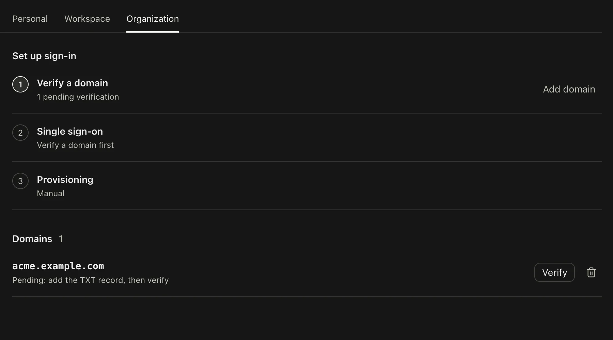

Đăng nhập một lần (SSO) cho phép nhóm của bạn đăng nhập CloudThinker qua identity provider (IdP) của công ty, chẳng hạn Okta, Microsoft Entra ID hoặc Google Workspace, để bạn quản lý quyền truy cập ở một nơi. Trang này đưa bạn từ một domain chưa xác minh tới một kết nối SSO hoạt động và được bắt buộc.

## Điều kiện tiên quyết

- Tổ chức ở gói **Scale** hoặc **Enterprise**. Ở các gói khác, **Settings → Organization → Identity** hiện **Unlock SSO with the Scale plan**, và Owner thấy nút **Upgrade plan**. Xem [Bảng giá](/vi/guide/billing/pricing).
- Role **Owner** của tổ chức. Chỉ Owner mới thay đổi được SSO. Admin mở được trang ở chế độ chỉ đọc và thấy **Only organization owners can change single sign-on**. Xem [Role và quyền](/vi/guide/security/roles).
- Quyền truy cập nhà cung cấp DNS để thêm một bản ghi TXT.
- Quyền quản trị trên identity provider.

## Quy trình thiết lập

**Settings → Organization → Identity** mở ra với mục **Set up sign-in** gồm ba hàng được đánh số. Mỗi hàng mở khóa hàng kế tiếp, và hàng đã xong hiển thị dấu tích.

| Hàng | Bạn làm gì | Xong khi |
|---|---|---|
| 1. **Verify a domain** | Chứng minh bạn sở hữu domain email bằng một bản ghi DNS TXT | Hàng hiển thị, ví dụ, **1 verified** |
| 2. **Single sign-on** | Tạo kết nối SAML hoặc OIDC tới identity provider | Hàng hiển thị tên kết nối, giao thức và **Active** |
| 3. **Provisioning** | Chọn cách tạo tài khoản người dùng | Hàng hiển thị **Just-in-time provisioning** hoặc **SCIM directory sync** |

<Frame caption="Organization → Identity: xác minh domain, thiết lập single sign-on, rồi chọn cách cấp tài khoản">
  
</Frame>

## Xác minh domain

Domain cho CloudThinker biết lượt đăng nhập nào cần chuyển tới identity provider của bạn. Bất kỳ ai có email thuộc domain đã xác minh đều được chuyển sang SSO.

<Steps>
  <Step title="Thêm domain">
    Vào **Settings → Organization → Identity**. Trên hàng **Verify a domain**, nhấn **Add domain**. Trong hộp thoại **Update organization email domains**, nhập domain email (ví dụ `example.com`), nhấn nút **+**, rồi đóng hộp thoại.

    Mỗi domain chỉ thuộc về một tổ chức CloudThinker. Nếu tổ chức khác đã nhận domain này, bạn sẽ thấy lỗi và cần liên hệ Owner của tổ chức đó.
  </Step>
  <Step title="Thêm bản ghi DNS TXT">
    Trong mục **Domains**, nhấn **Verify** cạnh domain. Hộp thoại **Verify domain** hiện hai giá trị. Tạo bản ghi TXT tại nhà cung cấp DNS với các giá trị đó:

    | Trường DNS | Giá trị |
    |---|---|
    | Name / Host | `_cloudthinker` (nhà cung cấp DNS tự thêm `.example.com`) |
    | Type | `TXT` |
    | Value | **Record Value** hiện trong hộp thoại, ví dụ `cloudthinker-domain-verification=Xy7...` |
  </Step>
  <Step title="Kiểm tra xác minh">
    Chờ bản ghi lan truyền, rồi nhấn **Check verification**. Việc lan truyền thường mất vài phút nhưng có thể lâu hơn, tùy nhà cung cấp DNS.

    **Trạng thái thành công:** domain hiện **Verified** trong mục **Domains**, và hàng **Single sign-on** hiển thị nút **Set up SSO**.

    CloudThinker chỉ kiểm tra bản ghi khi bạn nhấn **Check verification**. CloudThinker không kiểm tra lại sau đó, nên bạn có thể xóa bản ghi TXT khi domain đã được xác minh.
  </Step>
</Steps>

Bạn có thể xác minh nhiều domain, ví dụ `example.com` và `example.co.uk`. Khi kết nối đang hoạt động, bạn không gỡ được domain đã xác minh cuối cùng; hãy vô hiệu hóa kết nối trước.

## Tạo kết nối

Mỗi tổ chức có một kết nối SSO, phục vụ mọi domain đã xác minh. Chọn giao thức mà identity provider của bạn hỗ trợ. Nếu IdP hỗ trợ cả hai, giao thức nào cũng được; SAML là lựa chọn phổ biến nhất với IdP doanh nghiệp.

| Giao thức | Dùng khi | Hướng dẫn |
|---|---|---|
| **SAML 2.0** | IdP của bạn là Okta, Entra ID, Google Workspace, AWS IAM Identity Center, OneLogin hoặc một nhà cung cấp SAML 2.0 khác | [Thiết lập SAML](/vi/guide/security/sso-saml) |
| **OpenID Connect (OIDC)** | IdP của bạn cấp OAuth 2.0 client và công bố OIDC discovery document | [Thiết lập OIDC](/vi/guide/security/sso-oidc) |

<Steps>
  <Step title="Mở trình hướng dẫn">
    Trên hàng **Single sign-on**, nhấn **Set up SSO**. Chọn **SAML 2.0** hoặc **OpenID Connect (OIDC)** và nhấn **Next**.
  </Step>
  <Step title="Làm theo hướng dẫn của nhà cung cấp">
    Mở hướng dẫn SAML hoặc OIDC ở trên và hoàn tất các bước cho nhà cung cấp của bạn, rồi nhấn **Create Connection**.

    **Trạng thái thành công:** hộp thoại hiện **SSO Connection Created**. Kết nối hoạt động ngay, và đăng nhập qua SSO đã dùng được nhưng chưa bắt buộc.
  </Step>
  <Step title="Chạy kiểm tra kết nối">
    Trên hàng **Single sign-on**, nhấn **Edit**. Trong hộp thoại **Manage SSO**, ở tab **Overview**, ở mục **Connection test**, nhấn **Run connection test**.

    Bài kiểm tra kiểm tra cấu hình, không phải một lượt đăng nhập đầy đủ. Với SAML, bài kiểm tra kiểm tra IdP Entity ID, SSO URL và certificate. Với OIDC, bài kiểm tra kiểm tra discovery document truy cập được, issuer khớp, các endpoint bắt buộc tồn tại, và signing key truy cập được.

    **Trạng thái thành công:** **All checks passed**. Nếu bạn thấy **Some checks failed**, mục kiểm tra lỗi và thông báo lỗi sẽ được liệt kê; sửa giá trị trong tab **Configuration** và nhấn **Save Changes**.
  </Step>
  <Step title="Đăng nhập qua SSO">
    Trong cửa sổ trình duyệt ẩn danh, mở trang đăng nhập CloudThinker tại `https://app.cloudthinker.io/auth/login`, nhập một email thuộc domain đã xác minh, nhấn **Continue with email**, rồi nhấn **Continue with SSO**. Bạn cũng có thể nhấn **Sign in with SSO** và nhập **Work email**.

    **Trạng thái thành công:** trang đăng nhập của IdP mở ra, và sau khi đăng nhập bạn quay về CloudThinker với tên của mình hiển thị.
  </Step>
</Steps>

<Note>
  Ngay khi kết nối hoạt động, người mới thuộc domain đã xác minh không tạo được tài khoản bằng đăng nhập Google hay GitHub. Họ nhận thông báo "Your organization signs in with SSO." Người dùng hiện có vẫn chọn được **Use an email code instead** trên màn hình SSO cho đến khi bạn bắt buộc SSO.

  Người đã có tài khoản CloudThinker vẫn giữ tài khoản đó. Lượt đăng nhập SSO đầu tiên khớp tài khoản theo email và liên kết với IdP của bạn, nên không tạo tài khoản trùng.
</Note>

## Chọn cách cấp tài khoản người dùng

Provisioning là cách tài khoản CloudThinker được tạo cho một người trong công ty bạn. Mục **Provisioning** xuất hiện khi kết nối đã hoạt động.

| Chế độ | Điều gì xảy ra | Chọn khi |
|---|---|---|
| **Manual** | Không tự tạo tài khoản nào. Bạn mời từng người. | Bạn muốn tự tay duyệt từng thành viên |
| **Just-in-time** | Tài khoản được tạo lần đầu một người đăng nhập qua SSO. Đây là mặc định cho kết nối mới. | Bất kỳ ai được IdP cho vào đều nên có quyền truy cập |
| **SCIM** | IdP tự động tạo, cập nhật và vô hiệu hóa user và group | Bạn muốn directory xử lý người vào và người rời đi. Xem [Cấp tài khoản bằng SCIM](/vi/guide/security/scim) |

Với **Just-in-time** và **SCIM**, đặt thêm:

- **Auto-assigned organization role**: **Viewer** (mặc định), **Developer** hoặc **Admin**. Hãy bắt đầu với Viewer và nâng quyền sau.
- **Auto-assigned workspaces**: các workspace mà người dùng mới tự động tham gia. Mặc định là workspace mặc định của tổ chức. Xem [Workspace](/vi/guide/workspaces).

## Bắt buộc SSO

Khi SSO là tùy chọn, người thuộc domain của bạn vẫn đăng nhập được bằng mã qua email. Bật **Require single sign-on** sẽ bỏ lựa chọn đó.

<Steps>
  <Step title="Xác nhận SSO hoạt động với bạn">
    Hoàn tất bài kiểm tra đăng nhập ở trên bằng chính tài khoản của bạn trước.
  </Step>
  <Step title="Bật Require single sign-on">
    Trong mục **Sign-in rules**, bật **Require single sign-on**.

    **Trạng thái thành công:** công tắc vẫn bật. Người dùng thuộc các domain đã xác minh phải đăng nhập qua identity provider. Đăng nhập Google và GitHub bị từ chối với "Your organization signs in with SSO.", và **Use an email code instead** không còn đăng nhập được cho họ.
  </Step>
</Steps>

**Require single sign-on** được kiểm tra lúc đăng nhập. Thiết lập này không đăng xuất ai đang đăng nhập; họ chuyển sang SSO ở lần đăng nhập kế tiếp. Công tắc chỉ hiện khi kết nối ở trạng thái **Active**.

Bắt buộc SSO cũng thay đổi lời mời: bạn chỉ mời được email thuộc domain đã xác minh. Khi chọn **SCIM**, lời mời thủ công bị tắt, và bạn quản lý người dùng trong IdP.

### Nếu IdP không khả dụng

Mỗi tổ chức có đúng một Owner, và Owner được miễn **Require single sign-on**, nên sự cố IdP hay certificate hết hạn không khóa bạn ở ngoài. Owner nhập email trên trang đăng nhập, rồi chọn **Use an email code instead** trên màn hình SSO. Những người khác chờ đến khi IdP hoạt động trở lại, hoặc đến khi Owner tắt **Require single sign-on** trong **Sign-in rules**.

<Warning>
  Trước khi bật **Require single sign-on**, hãy đảm bảo địa chỉ email của Owner nhận được thư mà không phụ thuộc vào IdP, ví dụ một hộp thư chung có người theo dõi. Hộp thư đó là đường để bạn vào lại.
</Warning>

## Quản lý hoặc gỡ kết nối

Nhấn **Edit** trên hàng **Single sign-on**. Hộp thoại **Manage SSO** có hai tab:

| Tab | Bạn làm được gì |
|---|---|
| **Overview** | Xem **Status**, **Protocol**, **Display name**, **Verified domains**, **SCIM** và **Created**. **Activate**, **Deactivate** hoặc **Delete** kết nối, và chạy kiểm tra kết nối. |
| **Configuration** | Sửa giá trị IdP, ví dụ certificate đã xoay vòng hoặc client secret mới, rồi nhấn **Save Changes**. Với SAML, tab này còn hiện **SP Metadata URL**. |

| Trạng thái | Đạt được bằng cách nào | Người dùng thấy gì |
|---|---|---|
| **Active** | Tự động đặt khi bạn tạo kết nối hợp lệ trên domain đã xác minh, hoặc khi nhấn **Activate** | Lượt đăng nhập trên các domain đã xác minh đi tới IdP. **Require single sign-on** áp dụng nếu đang bật. |
| **Inactive** | Bạn nhấn **Deactivate** | SSO không được dùng. Mọi người đăng nhập bằng mã qua email, Google hoặc GitHub, và **Require single sign-on** không áp dụng. Thiết lập của bạn được giữ lại, nên **Activate** bật lại được. |
| **Testing** | Không đặt được từ dashboard | Hoạt động giống **Active** |

**Delete** là vĩnh viễn và làm nhiều hơn vô hiệu hóa:

- **Require single sign-on** mất theo kết nối, và người dùng quay về đăng nhập bằng mã qua email.
- SCIM bị gỡ: token ngừng hoạt động, group mapping và sync log bị xóa. Hãy tắt cả provisioning trong IdP.
- Tài khoản thành viên và role của họ được giữ lại, kể cả những người được tạo bằng just-in-time hoặc SCIM.

Để tạm dừng SSO, hãy vô hiệu hóa thay vì xóa.

## Khắc phục sự cố

<AccordionGroup>
  <Accordion title="Không có nút Set up SSO">
    Hàng **Single sign-on** hiển thị **Verify a domain first**. Mở **Verify** trên domain trong mục **Domains** và xác nhận tên bản ghi TXT là `_cloudthinker` và giá trị khớp chính xác với **Record Value**. Một số nhà cung cấp DNS tự thêm domain cho bạn, nên tên `_cloudthinker.example.com` có thể biến thành `_cloudthinker.example.com.example.com`. Sau đó nhấn **Check verification** lại.
  </Accordion>
  <Accordion title="Identity hiện Unlock SSO with the Scale plan">
    Gói của tổ chức bạn không bao gồm SSO. Owner nhấn **Upgrade plan**, hoặc xem [Quản lý gói đăng ký](/vi/guide/billing/subscription).
  </Accordion>
  <Accordion title="'Only organization owners can change single sign-on'">
    Bạn đang đăng nhập với role Admin, nên trang ở chế độ chỉ đọc. Nhờ Owner của tổ chức thực hiện thay đổi, hoặc [đổi role cho bạn](/vi/guide/security/roles).
  </Accordion>
  <Accordion title="Người dùng không đăng nhập được sau khi bạn bắt buộc SSO">
    Kiểm tra người dùng đã được gán ứng dụng CloudThinker trong identity provider. Nếu vẫn lỗi, Owner có thể tắt **Require single sign-on** trong lúc bạn sửa phía IdP.
  </Accordion>
  <Accordion title="Người dùng vẫn đăng nhập bằng mã qua email">
    Hoặc **Require single sign-on** đang tắt, hoặc email của người dùng không thuộc domain đã xác minh, hoặc người dùng là Owner của tổ chức, vốn được miễn theo thiết kế.
  </Accordion>
  <Accordion title="Tên hiện thành địa chỉ email">
    Identity provider không gửi họ và tên. Sửa attribute mapping theo hướng dẫn [SAML](/vi/guide/security/sso-saml) hoặc [OIDC](/vi/guide/security/sso-oidc).
  </Accordion>
  <Accordion title="Tìm nguyên nhân một lượt đăng nhập SSO thất bại">
    Khi người đó đã có tài khoản CloudThinker, lượt đăng nhập SSO thất bại được ghi vào [audit log](/vi/guide/security/audit-logs) dưới dạng `security.sso_login_failed`. Trong mọi trường hợp, hãy bắt đầu từ thông báo người dùng thấy trên trang đăng nhập CloudThinker:

    | Thông báo | Nguyên nhân |
    |---|---|
    | "SSO login is not available for this domain" | Domain của email chưa được xác minh, hoặc kết nối đang **Inactive** |
    | "No account found. Contact your administrator for access." | Provisioning là **Manual** hoặc **SCIM**, và người đó chưa có tài khoản hay lời mời |
    | "You are not a member of this organization. Please ask your administrator to invite you." | Người đó có tài khoản CloudThinker nhưng không thuộc tổ chức của bạn, và just-in-time provisioning đang tắt |
    | "This organization has reached its seat limit." | Lời mời đang chờ không chấp nhận được vì đã hết chỗ |
    | "SSO authentication did not provide an email address" | IdP không gửi email. Sửa attribute mapping |
    | "Your identity provider's signature could not be verified. Ask your administrator to check the SSO certificate." | CloudThinker không xác minh được chữ ký của IdP, ví dụ vì certificate SAML trong CloudThinker đã cũ |
    | "SSO sign-in failed. Try again or contact your administrator." | CloudThinker từ chối phản hồi SAML hoặc OIDC vì lý do khác, ví dụ assertion không ký hoặc bị mã hóa, hoặc lệch đồng hồ. Các lỗi khác hiển thị thông báo cụ thể hơn, nêu rõ cần kiểm tra gì. Xem phần khắc phục sự cố của [SAML](/vi/guide/security/sso-saml#khắc-phục-sự-cố) hoặc [OIDC](/vi/guide/security/sso-oidc#khắc-phục-sự-cố) |
  </Accordion>
</AccordionGroup>

## Bước tiếp theo

<CardGroup cols={2}>
  <Card title="Thiết lập SAML" icon="shield" href="/vi/guide/security/sso-saml">
    Cấu hình SAML từng bước cho Okta, Entra ID, Google Workspace và nhiều nhà cung cấp khác
  </Card>
  <Card title="Thiết lập OIDC" icon="id-badge" href="/vi/guide/security/sso-oidc">
    Cấu hình OIDC từng bước cho Google, Entra ID, Okta và các nhà cung cấp khác
  </Card>
  <Card title="Cấp tài khoản bằng SCIM" icon="users-gear" href="/vi/guide/security/scim">
    Để directory tự động thêm và gỡ người dùng
  </Card>
  <Card title="Role và quyền" icon="user-shield" href="/vi/guide/security/roles">
    Quyết định người dùng được cấp tự động làm được gì
  </Card>
</CardGroup>
