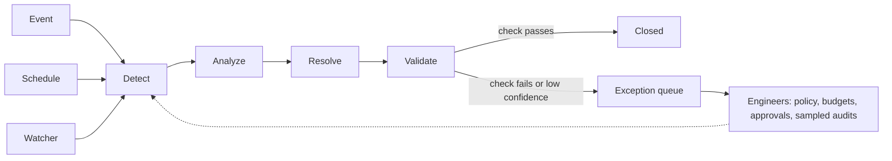

*Mười một chương đã xây dựng và gia cố một vòng lặp. Trạng thái cuối cùng là một đội ngũ các nhiệm vụ thường trực hẹp, tự khởi động, tự kiểm tra công việc và chạy theo chính sách, trong khi kỹ sư giám sát từ phía trên. Chương này vạch ra con đường đó và năm điều kiện giúp nó an toàn.*

## 12.1 Từ cuộc hội thoại đến nhiệm vụ thường trực

Hầu hết các triển khai hiện nay đều mang tính hội thoại. Một kỹ sư mở phiên, đặt câu hỏi, phê duyệt và đóng tab. Cách này vẫn dùng được, nhưng bị giới hạn ở sự chú ý của con người: agent chỉ làm việc khi có người theo dõi.

Đơn vị phá bỏ giới hạn đó là **nhiệm vụ**: một mục tiêu thường trực với trigger riêng, một tập hành động được phép có giới hạn, và một bước xác minh được tích hợp sẵn trong vòng lặp. "Giúp tôi với Kubernetes" không phải là nhiệm vụ. Những điều sau mới là nhiệm vụ:

- Review mọi pull request về tác động đến hạ tầng.
- Giữ lỗ hổng của image dưới một ngưỡng đã đặt.
- Giữ dịch vụ này đạt SLO.

Bạn không dùng nhiệm vụ như dùng một cuộc chat. Bạn giao nhiệm vụ, rồi giám sát hàng đợi kết quả và ngoại lệ của nhiệm vụ đó.

Nhiệm vụ được đánh thức theo ba cách, và một nền tảng production cần cả ba:

| Trigger | Ví dụ | Lưu ý thiết kế |
|---|---|---|
| **Sự kiện** | Một cảnh báo kích hoạt, một pull request được mở, một CVE xuất hiện, một phát hiện từ scanner đến | Lọc và nâng cấp sự kiện để vòng lặp tốn kém chỉ chạy trên những gì quan trọng (mô hình hai động cơ trong [Chương 4](/vi/learn/aio-engineer/chapter-4-orchestration-economics)) |
| **Lịch** | Quét chi phí hằng đêm, kiểm tra bản vá hằng tuần, dọn dẹp hằng ngày | Không hào nhoáng nhưng cộng dồn giá trị. Thường chiếm phần lớn công việc hằng ngày của agent trong các triển khai ban đầu |
| **Watcher** | Mức tiêu hao SLO, độ lệch cấu hình, chi tiêu so với đường cơ sở | Duy trì đường cơ sở liên tục thay vì trả lời một câu hỏi |

Chat không biến mất. Chat trở thành nơi xử lý ngoại lệ: nơi bạn chất vấn công việc của nhiệm vụ, không phải nơi công việc diễn ra.

## 12.2 Nhiệm vụ theo chiều dọc: tự chủ nhờ phạm vi hẹp

[Chương 7](/vi/learn/aio-engineer/chapter-7-evaluating-agents) cho thấy với bài toán giải quyết sự cố mở, agent trên các model hiện tại giải quyết khoảng một trong bảy kịch bản benchmark SRE. Điều đó không có nghĩa phải nhiều năm nữa mới có tự chủ. Điều đó có nghĩa là quyền tự chủ được giành theo từng nhiệm vụ, và nhiệm vụ càng hẹp càng giành được sớm. Thu hẹp mục tiêu, giới hạn hành động và làm cho khâu xác minh rẻ, thì chính những model đó trở nên đủ chuẩn production vì harness có thể kiểm tra công việc của chúng.

| Nhiệm vụ | Trigger | Vòng lặp | Xác minh |
|---|---|---|---|
| Code review | Mọi pull request | Tác động đến hạ tầng, bảo mật và thay đổi chi phí trong diff | Bình luận của agent chỉ mang tính tư vấn, và con người vẫn merge |
| Duy trì infrastructure-as-code | Lịch cộng sự kiện độ lệch | Đồng bộ độ lệch, cập nhật dependency, vá image | Review plan-diff, và CI phải chạy thành công |
| Ứng phó sự cố | Cảnh báo hoặc sự kiện được nâng cấp | Phát hiện, phân tích, giải quyết và xác thực trên các lớp lỗi đã biết | Probe phục hồi SLO cộng rollback tự động |
| Bảo mật | Nguồn CVE cộng quét theo lịch | Phân loại phát hiện, xác nhận mức phơi nhiễm, vá hoặc chuyển cấp | Quét lại chứng minh phát hiện đã biến mất |
| Chi phí | Quét hằng đêm | Điều chỉnh kích thước, dọn tài nguyên mồ côi, đánh dấu bất thường | Thay đổi trên hóa đơn; mọi hành động đều đảo ngược được |

Cột cuối cùng là cột quan trọng. Mỗi nhiệm vụ khép lại bằng một bước kiểm tra mà máy tự chạy: quét lại, plan-diff, cổng CI, probe SLO, một dòng trên hóa đơn. Điều đó cho bạn quy tắc nâng cấp trong một câu:

<Note>
Nhiệm vụ giành được quyền tự chủ khi xác minh rẻ hơn giám sát.
</Note>

Ở những nơi xác minh tốn kém hoặc cần phán đoán, nhiệm vụ vẫn phải qua cổng kiểm soát. Thay đổi kiến trúc, xóa tài nguyên có trạng thái và mọi thứ không thể đảo ngược thuộc nhóm này. Giữ cổng kiểm soát cho những việc này nghĩa là hệ thống đang hoạt động đúng.

## 12.3 Kỹ sư đứng trên vòng lặp, không nằm trong vòng lặp

"Human in the loop" che giấu một mức trần. Nếu một người phải nhấn đồng ý cho mọi hành động, thì bạn chỉ tạo ra một kỹ sư chậm hơn. Phê duyệt từng hành động là một giai đoạn, không phải đích đến. Đích đến là "on the loop": kỹ sư đặt các cơ chế kiểm soát và xử lý những gì cơ chế kiểm soát không thể quyết định.

| Cơ chế kiểm soát | Chức năng |
|---|---|
| **Chính sách** | Quyết định những gì chạy không cần giám sát, theo từng nhiệm vụ và từng phạm vi ảnh hưởng ([Chương 6](/vi/learn/aio-engineer/chapter-6-policy-approvals)) |
| **Phê duyệt** | Dành cho các hành động không thể đảo ngược |
| **Hàng đợi ngoại lệ** | Thu thập các trường hợp độ tin cậy thấp và ngoài chính sách để con người phán đoán |
| **Kiểm tra mẫu** | Kiểm tra lại một phần công việc không giám sát mỗi tuần, vì suy giảm âm thầm là cách niềm tin sụp đổ |
| **Ngân sách** | Giới hạn chi tiêu, số hành động và token để dừng một vòng lặp mất kiểm soát trước khi gây thiệt hại |

Việc nâng cấp diễn ra theo từng nhiệm vụ và dựa trên bằng chứng, giống như cách bạn đưa mã lên production. Nhiệm vụ bắt đầu ở chế độ chỉ đọc. Tiếp theo, nhiệm vụ đề xuất thay đổi để con người phê duyệt. Sau đó, các hành động cụ thể, đảo ngược được chạy không cần giám sát trong phạm vi chính sách. Mỗi bước cần điểm đánh giá đạt và lịch sử sự cố sạch (các cổng trong [Chương 7](/vi/learn/aio-engineer/chapter-7-evaluating-agents)), và một nhiệm vụ có thể bị hạ cấp theo cùng cách.

Việc giám sát không còn là một cuộc họp mà trở thành một control plane gồm chính sách, ngân sách, hàng đợi và màn hình kiểm toán. Giám sát mười nhiệm vụ theo cách này là một công việc bán thời gian. Làm mười nhiệm vụ đó bằng tay là mười công việc.

## 12.4 Năm điều kiện, nói thẳng

Tương lai này có điều kiện. Mỗi điều kiện là một chương của cuốn sách này. Dùng bảng này làm bước kiểm tra mức độ sẵn sàng trước khi để bất kỳ nhiệm vụ nào chạy không giám sát.

| # | Điều kiện | Vì sao bắt buộc | Được xây dựng trong |
|---|---|---|---|
| 1 | Xác minh rẻ hơn giám sát | Thiếu điều này, tự chủ chỉ là rủi ro chưa được định giá | [Chương 7](/vi/learn/aio-engineer/chapter-7-evaluating-agents) |
| 2 | Nền tảng hướng sự kiện | Nhiệm vụ cần luồng sự kiện và bộ lập lịch, không phải ô chat | [Chương 4](/vi/learn/aio-engineer/chapter-4-orchestration-economics) |
| 3 | Chính sách, phê duyệt và an toàn thực thi dưới dạng mã | Hành động không giám sát mà thiếu guardrail máy đọc được là sự cẩu thả | [Chương 6](/vi/learn/aio-engineer/chapter-6-policy-approvals) |
| 4 | Khả năng quan sát ở mức trace | Bạn không thể kiểm tra những gì mình không ghi lại | [Chương 8](/vi/learn/aio-engineer/chapter-8-observing-the-observer) |
| 5 | Kỷ luật vận hành đội ngũ | Nhiệm vụ có phiên bản, triển khai canary và đường cong chi phí, vì năm mươi vòng lặp thường trực là một hệ thống production | [Chương 9](/vi/learn/aio-engineer/chapter-9-agentops-day-2) |

Các nhóm đáp ứng đủ cả năm vận hành bằng ý định cộng ngoại lệ. Các nhóm không đáp ứng điều nào sẽ nhận ra "tự động" chỉ là một cái nhãn.

## 12.5 Xây dựng tương lai

Sự chuyển đổi đến từng nhiệm vụ một, theo thứ tự đại khái như sau:

1. **Code review** chạy không giám sát trước tiên, dưới dạng bình luận tư vấn, vì việc xác minh gần như miễn phí.
2. Nhiệm vụ **chi phí** theo sau, vì mọi hành động đều đảo ngược được.
3. **Bảo mật và ứng phó sự cố** được nâng cấp từng lớp lỗi một. Hỗ trợ mỗi lần nâng cấp bằng một [golden set](/vi/learn/aio-engineer/appendix-c-glossary#đánh-giá) ([Chương 7](/vi/learn/aio-engineer/chapter-7-evaluating-agents)) và ba tháng kiểm tra mẫu sạch.

Không điều gì trong số này phải chờ một model thông minh hơn. Điều cần chờ là một harness mạnh hơn. Để bắt đầu, hãy chọn một nhiệm vụ đảo ngược được, chạy ở chế độ chỉ đọc trong hai tuần, rồi nâng cấp nó một bậc.

<Info>
**Trong thực tế: nhiệm vụ trên CloudThinker**

CloudThinker chạy các nhiệm vụ này trên một tập [kết nối](/vi/guide/connections/overview) dùng chung, một hệ thống [Approvals](/vi/guide/approvals/overview) và một [nhật ký kiểm toán](/vi/guide/security/audit-logs).

| Dạng nhiệm vụ | Nơi chạy hiện nay |
|---|---|
| Mọi pull request | [Review](/vi/guide/code-review/overview) review từng pull request hoặc merge request trên các repository bạn chọn, không cần ai khởi động. Review đăng một bình luận tóm tắt và các phát hiện inline. Con người vẫn quyết định merge. |
| Hướng sự kiện | [Pulse](/vi/guide/pulse/overview) nhóm cảnh báo đến thành cluster, loại bỏ nhiễu và chuyển các cluster cần hành động cho bước phân loại của [Resolve](/vi/guide/incident/overview) |
| Theo lịch hoặc theo trigger | [Automations](/vi/guide/automation/automations) chạy hướng dẫn đã lưu theo lịch, theo lệnh gọi webhook hoặc theo sự kiện repository |
| Watcher | [Probe](/vi/guide/automation/automations#probe) là trigger watcher: một script bash kiểm tra một điều kiện mỗi 5, 15, 30 hoặc 60 phút và khởi động một lượt chạy khi điều kiện xảy ra. Yêu cầu trong chat, ví dụ "Watch the orders-api p95 latency every 15 minutes and start a run if it's above 800 ms." |
| Kiểm thử bảo mật theo lịch | [Cyber](/vi/guide/security/cyber-overview) chạy pentest trên ứng dụng web và API đang chạy theo lịch, và kiểm thử lại một phát hiện sau khi bạn sửa. Đây không phải nhiệm vụ theo nguồn CVE. Để phân loại CVE của image hoặc package, hãy trỏ scanner của bạn đến trigger webhook của một Automation. |
| Chi phí | [Optimize](/vi/guide/cost-optimization/overview) quét dữ liệu thanh toán AWS, GCP hoặc Azure ở chế độ chỉ đọc và xếp hạng các phát hiện tiết kiệm. **Implement** trên một [phát hiện](/vi/guide/cost-optimization/recommendations) thực hiện thay đổi, và thay đổi đó đi qua Rule và Approval mode của bạn như mọi thao tác ghi khác. |

**Thang nâng cấp trong cài đặt**

| Bước | Thiết lập |
|---|---|
| Chỉ đọc | Kết nối bằng thông tin xác thực viewer hoặc chỉ đọc. Trên AWS, Google Cloud và Azure, tắt thêm **Allow writes** trên [kết nối](/vi/guide/connections/overview). |
| Đề xuất, con người phê duyệt | [Approval mode](/vi/guide/approvals/approval-mode) **Manual**: một người phê duyệt mọi thao tác ghi |
| Không giám sát trong phạm vi chính sách | Chế độ **Auto**, với các [Rule](/vi/guide/approvals/rules) **Allow** cho những thao tác ghi cụ thể, đảo ngược được. Đặt **Runs from** thành **Automations** để Rule chỉ bao phủ công việc theo lịch. |

Mọi thao tác ghi đều qua Rule của bạn trước, rồi đến Approval mode, dù Rule chỉ quyết định khi CloudThinker bật Rule enforcement cho workspace của bạn. Automation mặc định là **Auto · Rules + AI · Refuse**: Rule quyết định trước, sau đó AI judgment cho phép thao tác ghi an toàn mà không Rule nào bao phủ, và bất cứ thứ gì vẫn chưa được quyết định sẽ bị từ chối, vì có thể không ai trực tuyến để trả lời. Xem [bốn lựa chọn Auto](/vi/guide/approvals/approval-mode#hai-chế-độ).

**Các cơ chế kiểm soát on-the-loop**

| Cơ chế kiểm soát | Nằm ở đâu |
|---|---|
| Hàng đợi ngoại lệ | Thao tác ghi đang chờ một người hiển thị thẻ phê duyệt trong cuộc hội thoại của lượt chạy, và lượt chạy hiển thị **Required Approval** trên tab **Runs** của **Automations**. **Approvals → Overview** cho biết những gì cần bạn và bao nhiêu lệnh gọi đã bị từ chối trong 7 ngày gần nhất. Thao tác ghi bị từ chối không làm lượt chạy thất bại, nên hãy đọc cuộc hội thoại để xem những gì đã bị bỏ qua. |
| Kiểm tra mẫu | [Activity](/vi/guide/activity) liệt kê mọi lượt chạy kèm trạng thái. **Approvals → Activity** cho biết mỗi Rule đã quyết định gì và xuất ra CSV. [Audit Logs](/vi/guide/security/audit-logs) lọc theo tác nhân, ví dụ **Actor Type: Agent**. |
| Ngân sách | [Giới hạn credit](/vi/guide/billing/credit-limits) đặt mức trần chi tiêu hằng tháng cho mỗi workspace |
| Công tắc dừng khẩn cấp | Không có một công tắc duy nhất dừng mọi thứ. Cơ chế hoạt động hiện nay là **Allow writes**: tắt tùy chọn này trên một kết nối và mọi thay đổi trên kết nối đó đều bị từ chối. Đặt từng loại lượt chạy thành **Manual** sẽ chuyển thao tác ghi của loại đó cho một người, nhưng chỉ vậy thôi chưa phải là dừng, vì một cuộc chat có thể tự chọn chế độ trong ô soạn tin. Tắt **On duty** trong Resolve để dừng các cuộc điều tra tự động, và tắt trigger của một automation để dừng các lượt chạy của nó. Khi CloudThinker bật [Rule enforcement](/vi/guide/approvals/rules#khắc-phục-sự-cố) cho workspace của bạn, Rule bổ sung một cơ chế dừng rộng hơn. [Rule](/vi/guide/approvals/rules) **Deny** áp cho mọi thao tác, trên mọi kết nối, với **Never allow break-glass** bật, sẽ từ chối mọi thao tác ghi của agent ở mọi chế độ trong khi lệnh đọc vẫn tiếp tục chạy. Hãy diễn tập điều này trước khi bạn cần đến. |

Audit Logs và giới hạn credit cần gói Scale, Scale Plus hoặc Enterprise.
</Info>

<Tip>
**Điểm chính**

Tương lai là một đội ngũ các nhiệm vụ thường trực hẹp, kích hoạt theo sự kiện, lịch và watcher. Mỗi nhiệm vụ giành được quyền tự chủ khi xác minh rẻ hơn giám sát, theo chính sách và ngân sách, với kỹ sư đứng trên vòng lặp để phán đoán ngoại lệ. Harness giành quyền tự chủ theo từng nhiệm vụ. Model không cấp quyền đó theo từng nền tảng.
</Tip>

## Bước tiếp theo

Bắt đầu với nhiệm vụ mà mục 12.5 khuyến nghị đầu tiên: thiết lập [Review](/vi/guide/code-review/setup) trên một repository. Với nhiệm vụ theo lịch đầu tiên, làm theo [Bắt đầu nhanh với Automation](/vi/guide/automation/quickstart). Nếu bạn đang đánh giá một nền tảng, hãy đưa [Phụ lục A · Kế hoạch kiểm thử POC](/vi/learn/aio-engineer/appendix-a-poc-test-plan) vào bản proof of concept của bạn.
