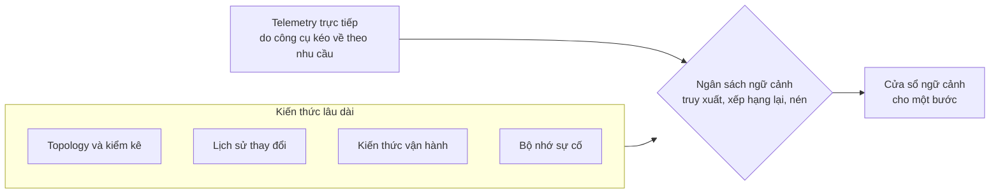

*Cho hai agent cùng một model, cùng công cụ và cùng một sự cố, một agent vẫn có thể hữu ích hơn hẳn agent kia. Khác biệt nằm ở ngữ cảnh: những gì agent được cung cấp để suy luận.*

## 2.1 Vì sao ngữ cảnh quan trọng hơn lựa chọn model

Các model tiên tiến ngày càng có thể thay thế cho nhau trong suy luận vận hành. Những gì chúng được cung cấp thì không. Agent biết topology, lịch sử triển khai, quy ước và các sự cố trước đây của bạn sẽ chẩn đoán tốt hơn cả một model thông minh hơn nhưng không biết những điều đó.

**Context engineering** là việc thiết kế có chủ đích những gì đi vào cửa sổ ngữ cảnh của model (văn bản mà model đọc ở mỗi bước), cách chúng được cấu trúc, và khi nào chúng bị loại bỏ hoặc làm mới. Hai bài học từ thực tiễn hiện nay làm nền tảng cho cách làm này:

- **Cửa sổ lớn hơn không giải quyết được vấn đề.** Chất lượng model giảm khi cửa sổ đầy tài liệu không liên quan. Chọn lọc tốt hơn tích lũy.
- **Ngữ cảnh nhân chi phí lên.** Khi nhiều agent cùng làm một tác vụ, mỗi agent đều trả tiền cho mọi token mình mang theo. Chỉ gửi cho mỗi agent những gì tác vụ của nó cần là điều giữ cho bài toán kinh tế khả thi (Chương 4).

Quy tắc thực tế: khi một agent hoạt động kém, hãy kiểm tra ngữ cảnh của agent trước khi đổ lỗi cho model. Mục 2.6 cung cấp checklist.

## 2.2 Năm nguồn ngữ cảnh của một agent vận hành

| Nguồn | Chứa gì | Cách đi vào vòng lặp | Điều gì hỏng khi thiếu hoặc lỗi thời |
|---|---|---|---|
| **Topology và kiểm kê** | Dịch vụ, phụ thuộc, tài nguyên, người sở hữu | Được khám phá và làm mới tự động | Câu hỏi "Điều gì đã thay đổi ở phía thượng nguồn của triệu chứng?" không có câu trả lời. Topology lỗi thời còn tệ hơn không có, vì agent tin vào nó. |
| **Lịch sử thay đổi** | Lần triển khai, thay đổi cấu hình, thay đổi hạ tầng, feature flag, theo thứ tự thời gian kèm tác giả | Được truy vấn theo từng cuộc điều tra | Hầu hết sự cố đều tương quan với một thay đổi. Không có luồng thay đổi, agent điều tra như bị nhắm một mắt. |
| **Kiến thức vận hành** | Runbook, định nghĩa SLO, ghi chú kiến trúc, quy ước ("chúng tôi luôn drain trước khi scale down"), các mẫu lỗi đã biết | Được truy xuất theo từng tác vụ | Agent đưa ra lời khuyên chung chung thay vì quy trình của bạn. Kiến thức chưa hoàn hảo vẫn ổn; không có kiến thức thì không. |
| **Bộ nhớ sự cố** | Các cuộc điều tra trước: nguyên nhân gốc, điều gì đã sửa được, điều gì không | Được gợi lại khi bắt đầu một cuộc điều tra | Lỗi xảy ra lần thứ hai vẫn tốn thời gian như lần đầu. |
| **Telemetry trực tiếp** | Metric, log, trace, event | Được công cụ kéo về theo nhu cầu trong vòng lặp, không bao giờ tải hàng loạt | Agent suy luận từ một bức tranh lỗi thời hoặc không đầy đủ. |

Bốn nguồn đầu là kiến thức lâu dài, được tập hợp theo từng tác vụ. Nguồn thứ năm được lấy từng bước: tầng ngữ cảnh quyết định điều gì đáng kéo về, tầng công cụ kéo nó về (Chương 3), và bước tóm tắt quyết định điều gì được giữ lại cho bước tiếp theo.



## 2.3 Tập hợp: ngân sách ngữ cảnh

Hãy coi cửa sổ ngữ cảnh là một tài nguyên production có ngân sách và chính sách phân bổ. Đây là các ô cần phân bổ cho một bước điều tra. Xác định kích thước của chúng từ trace của chính bạn: ghi lại số token mỗi ô sử dụng trên một mẫu các cuộc điều tra, rồi giới hạn working set trước tiên, vì kết quả công cụ thường là hạng mục lớn nhất (Chương 1).

| Ô | Nội dung | Quy tắc |
|---|---|---|
| Lõi hệ thống | Danh tính, chính sách, định dạng đầu ra | Ổn định qua các bước |
| Khung tác vụ | Hồ sơ sự cố tính đến hiện tại | Được ghim, để không bị cuộn mất |
| Kiến thức được truy xuất | Một vài runbook liên quan nhất và các sự cố tương tự trong quá khứ | Được xếp hạng lại, mỗi mục có trích dẫn về nguồn |
| Working set | Kết quả công cụ | Kết quả gần đây giữ nguyên văn; kết quả cũ hơn thành bản tóm tắt do agent viết kèm con trỏ đến dữ liệu đầy đủ |

Kỷ luật truy xuất quan trọng hơn công nghệ truy xuất. Truy xuất rộng, rồi xếp hạng lại thật chặt xuống còn một vài mục chính xác. Đổ năm mươi đoạn vào cửa sổ sẽ thất bại theo cách đo lường được: model bỏ sót các sự thật bị chôn ở giữa ngữ cảnh dài (Liu et al., ["Lost in the Middle"](https://arxiv.org/abs/2307.03172), TACL 2024).

Loại bỏ là nửa còn lại. Các cuộc điều tra dài phải **nén**: agent tự tóm tắt quỹ đạo của mình ("đã kiểm tra X, loại trừ Y vì Z"), bỏ các đoạn trích thô, và giữ con trỏ để mọi khẳng định có thể được mở rộng và kiểm tra sau này. Nén cũng là nơi sự bịa đặt lẻn vào. Mọi bản tóm tắt phải truy ngược được về bằng chứng mà nó nén lại, nên bản tóm tắt là một mục tiêu đánh giá trong Chương 7.

<Info>
**TRONG THỰC TẾ: ĐẦU RA CÔNG CỤ QUÁ LỚN**

CloudThinker nén một kết quả công cụ quá lớn trước khi model đọc và giữ bản gốc đầy đủ trong sandbox của cuộc hội thoại, để agent có thể mở lại dữ liệu thô khi một khẳng định cần kiểm tra. Một truy vấn log lớn chỉ tốn lượng ngữ cảnh của một bản tóm tắt, không phải toàn bộ dữ liệu.
</Info>

## 2.4 Bộ nhớ: ghi gì, để suy giảm gì

Bộ nhớ lâu dài là thứ khiến một triển khai agent khó bị sao chép, nhưng bộ nhớ đó cũng có thể âm thầm mục ruỗng. Bốn quy tắc đứng vững trong production:

1. **Ghi kết luận, không ghi bản chép lời.** Lưu triệu chứng, nguyên nhân gốc, bản sửa và cách xác minh, không lưu quỹ đạo 300.000 token. Dùng cấu trúc cố định để truy xuất khớp theo mẫu, không theo câu chữ.
2. **Ghi nguồn gốc cho mọi mục bộ nhớ.** Ai đã viết (con người, agent, import), từ sự cố nào, khi nào và độ tin cậy ra sao. Bộ nhớ không rõ nguồn gốc là cách một kết luận sai đầu độc hàng trăm cuộc điều tra sau đó.
3. **Suy giảm và chất vấn.** Thay đổi topology làm mất hiệu lực các đường nhân quả cũ. Giảm trọng số của bộ nhớ cũ, và để bằng chứng mâu thuẫn đánh dấu một mục bộ nhớ cần review thay vì để hai thứ âm thầm cùng tồn tại.
4. **Giữ một tầng do con người quản lý.** Một lớp nhỏ, độ tin cậy cao gồm các quy ước và quyết định thường trực ("không bao giờ làm X trên cluster thanh toán") mà chỉ con người được sửa và luôn được ưu tiên hơn bộ nhớ học được. Đây vừa là một bề mặt chính sách vừa là một bề mặt chất lượng.

<Info>
**TRONG THỰC TẾ: BỘ NHỚ SỰ CỐ CÓ CẤU TRÚC**

[Incident memory](/vi/guide/incident/incident-memory) trong CloudThinker tuân theo các quy tắc này. Mỗi cuộc điều tra đi đến một kết luận xử lý sẽ ghi một bản hồi ức với cấu trúc cố định:

```text
Symptom: checkout-api 5xx rate above 20% on target group tg-checkout at 14:02 (CloudWatch)
Root cause: Inferred. Connection pool exhausted after max connections was lowered
Origin changed: unknown
Fix: operator-applied. Pool size restored to its previous value
Verify-with: 5xx rate on tg-checkout over 15 minutes; expected below 1%
```

| Trường | Ghi lại gì |
|---|---|
| `Symptom` | Điều đã quan sát, kèm nguồn, đối tượng và thời gian |
| `Root cause` | Cơ chế được chứng minh và nhãn bằng chứng yếu nhất của nó: **Inferred** (suy luận từ bằng chứng, chưa được xác nhận trực tiếp) hoặc **Verified** (đã xác nhận với dữ liệu từ hệ thống của bạn), hoặc `unknown` |
| `Origin changed` | Thay đổi quan sát được đằng sau lỗi và nguồn của nó, hoặc `unknown`. Không bao giờ được đoán từ trạng thái hiện tại. |
| `Fix` | `none`, `proposed`, `operator-applied` (một người đã áp dụng) hoặc `agent-applied`, kèm người thực hiện |
| `Verify-with` | Một kiểm tra có phạm vi, đối tượng và kết quả mong đợi. Đây là một kiểm tra cần chạy, không phải bằng chứng là kiểm tra đã đạt. |

Mục được gợi lại chỉ là manh mối, không bao giờ là bằng chứng: kết luận vẫn dựa trên dữ liệu từ hệ thống của bạn. Mỗi bản hồi ức là câu chuyện của một sự cố. **Bài học** là mẫu thấy được qua nhiều sự cố, và chỉ được giữ lại nếu trích dẫn ít nhất hai sự cố. Bản sửa mà bước kiểm tra tiếp theo thất bại vẫn được lưu lại như một phản ví dụ.

Ngoài sự cố, [bộ nhớ workspace](/vi/guide/memory) là tầng do con người quản lý. Mọi thành viên đều đọc được và sửa được bằng lời thông thường, chỉ Admin của workspace mới sửa hoặc xóa trực tiếp một mục, và lượt chạy [Dreaming](/vi/guide/memory-dreaming) hằng đêm gộp các bản trùng lặp và loại bỏ những gì các cuộc hội thoại mới hơn mâu thuẫn.
</Info>

## 2.5 Khám phá: ngữ cảnh như quá trình onboarding

Các nền tảng mạnh nhất coi việc thu thập ngữ cảnh là một giai đoạn của sản phẩm, không phải một yêu cầu viết tài liệu. Khi kết nối, hệ thống duyệt tài khoản hoặc cluster ở chế độ chỉ đọc, ghi lại những gì tồn tại và cách chúng được thiết lập, và cho con người xem hệ thống đã hiểu gì trước khi bất cứ điều gì khác xảy ra.

Khám phá giúp agent hữu ích ngay từ ngày đầu và an toàn hơn về sau: hệ thống hiểu hạ tầng có thể dự đoán phạm vi ảnh hưởng trước khi yêu cầu thay đổi bất cứ thứ gì. Đây cũng là nền tảng cho cách vận hành mà không ai phải ra lệnh, vì hệ thống đã hiểu hạ tầng đủ rõ để tự mang đến phát hiện, kế hoạch và bằng chứng để phê duyệt. Không có tầng ngữ cảnh, hướng đi đó là liều lĩnh.

<Info>
**TRONG THỰC TẾ: KHÁM PHÁ TRƯỚC KHI HÀNH ĐỘNG**

Lần đầu tiên một [kết nối](/vi/guide/connections/overview) đạt trạng thái **Connected**, CloudThinker chạy **Discovery**, một cuộc điều tra nền về dịch vụ bạn vừa kết nối, trong tối đa 30 phút. Khi hoàn tất, phần **Discovery** trong bảng chi tiết của kết nối sẽ hiển thị bằng chứng (mỗi dữ kiện dẫn nguồn từ lần đọc tạo ra dữ kiện đó), các kết nối liên quan đáng thêm vào, và các kiểm tra định kỳ được đề xuất mà bạn có thể biến thành [automation](/vi/guide/automation/automations). Thao tác đọc chạy tự do; mọi thay đổi vẫn đi qua [Approvals](/vi/guide/approvals/overview). Discovery chạy một lần cho mỗi kết nối. Sau khi bạn mở rộng quyền của thông tin xác thực, hoặc nạp thêm credit nếu Discovery tạm dừng vì số dư thấp, hãy nhấn **Run Discovery** trên kết nối để chạy lại (vai trò Admin của workspace).

Câu hỏi cần đặt ra với bất kỳ nền tảng nào: nền tảng đó biết gì về hạ tầng của bạn một giờ sau khi kết nối, và có cho bạn xem được bằng chứng không?
</Info>

## 2.6 Kiểm tra ngữ cảnh của một agent

Chạy checklist này khi một agent đưa ra câu trả lời yếu hoặc sai, trước khi bạn đổi model hay prompt:

| Câu hỏi | Nếu câu trả lời là không |
|---|---|
| Agent có thấy được các phụ thuộc và người sở hữu của dịch vụ không? | Kết nối nguồn còn thiếu, hoặc nhấn **Run Discovery** trên kết nối |
| Agent có thấy các thay đổi được thực hiện trong một giờ trước triệu chứng không? | Kết nối nguồn triển khai hoặc nguồn thay đổi |
| Agent có truy xuất runbook của bạn cho lớp lỗi này không? | Thêm runbook vào một [knowledge base](/vi/guide/knowledge), hoặc biến nó thành một [skill](/vi/guide/skills/overview) nếu đó là một quy trình |
| Agent có gợi lại lần xảy ra trước của sự cố này không? | Mở sự cố trước đó trong **Resolve → Investigation** và xác nhận nó hiển thị **Current assessment** và một kết quả đã đóng. Không có kết luận xử lý nghĩa là không có bản hồi ức nào được ghi. Xem [Incident memory](/vi/guide/incident/incident-memory). |
| Mọi khẳng định trong bản tóm tắt có truy về một kết quả công cụ không? | Coi bản tóm tắt là chưa được xác minh và đánh giá bước nén (Chương 7) |

<Tip>
**ĐIỂM CHÍNH**

Ngữ cảnh vừa là con hào bảo vệ vừa là điểm thất bại. Hãy thiết kế ngữ cảnh như một hệ thống con: năm nguồn, một chính sách tập hợp có ngân sách, nén truy vết được, bộ nhớ gắn nguồn gốc có suy giảm, và khám phá tự động. Khi một agent hoạt động kém, hãy kiểm tra ngữ cảnh của agent trước khi đổ lỗi cho model.
</Tip>

## Bước tiếp theo

<CardGroup cols={2}>
  <Card title="Chương 3 · Tools, Skills, and the Protocol Layer" icon="toolbox" href="/vi/learn/aio-engineer/chapter-3-tools-skills-protocol">
    Thiết kế công cụ quyết định độ an toàn và độ tin cậy ra sao, và cách vận hành MCP trong production.
  </Card>
  <Card title="Bộ nhớ workspace" icon="brain" href="/vi/guide/memory">
    Xem, dạy và sửa những gì CloudThinker ghi nhớ về workspace của bạn.
  </Card>
</CardGroup>
