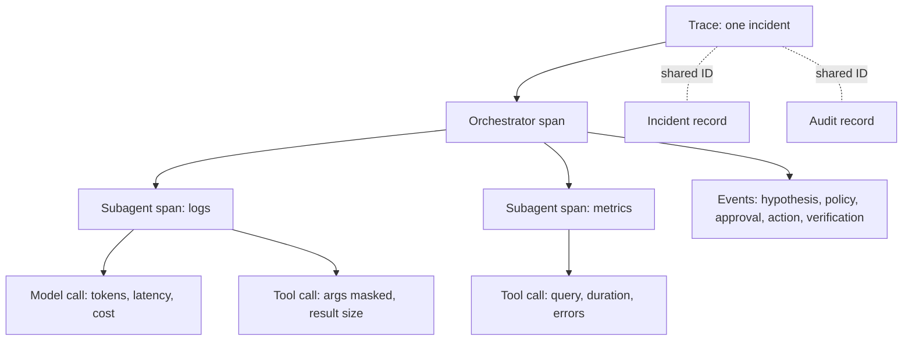

*Bạn sẽ không bao giờ vận hành một dịch vụ production mà không có trace, metric và SLO, và một đội agent cũng là một dịch vụ production mà lỗi của nó là những quyết định sai, không phải exception. Chương này chỉ ra cần đo đạc những gì và con số nào xứng đáng có SLO.*

## 8.1 Vì sao observability cho agent khác biệt

Agent có thể trông khỏe mạnh trên mọi tín hiệu kinh điển (không exception, phản hồi nhanh, HTTP 200) mà vẫn sai một cách tự tin. Vì vậy log request và response là không đủ. Bạn cần **đồ thị quyết định**: agent đã thấy gì, đã cân nhắc gì, đã gọi công cụ nào với đối số nào, kết quả trả về là gì, agent kết luận gì, và đã tiêu tốn bao nhiêu.

Ngành đang hội tụ về **OpenTelemetry GenAI semantic conventions**, một schema chung cho lệnh gọi model, span của agent và công cụ, lượng token sử dụng và chi phí. Các nhà cung cấp observability lớn đều tiếp nhận schema này, và các framework agent phổ biến đều phát telemetry theo schema này. Các quy ước cho công việc đa agent (tác vụ, chuyển giao, thao tác memory) vẫn đang được soạn thảo trong nhóm làm việc OpenTelemetry GenAI.

Quy tắc khi mua sắm suy ra từ đó. Telemetry của agent theo schema mở nghĩa là bạn có thể mang nó đi nơi khác và kiểm toán được. Telemetry theo định dạng độc quyền sẽ khóa bạn ở đúng lớp mà bạn ít có khả năng chịu đựng nhất.

Hãy áp cùng quy tắc đó cho CloudThinker. Hiện tại CloudThinker không xuất trace OpenTelemetry GenAI sang backend của riêng bạn. Những gì bạn có thể lấy ra là CSV **Audit Logs** (mọi hành động của agent và con người), CSV **Approvals → Activity** (những gì mỗi Rule đã quyết định), và các góc nhìn trên trang **Usage**. Bảng ở cuối chương này cho biết từng thứ nằm ở đâu.

## 8.2 Cấu trúc của một trace

Ghi một trace cho mỗi sự cố, với các cấp lồng nhau như sau:

| Cấp | Span | Cần ghi lại gì |
|---|---|---|
| Gốc | Tác vụ (một sự cố hoặc một yêu cầu) | ID sự cố, trigger, thời điểm bắt đầu và kết thúc, kết quả cuối cùng |
| Con | Mỗi lần gọi agent (orchestrator và mọi subagent) | Tên agent, mục tiêu được giao, tổng token và chi phí |
| Cháu | Lệnh gọi model | Model, token vào và ra, độ trễ, chi phí |
| Cháu | Lệnh gọi công cụ | Tên công cụ, đối số với secret đã được che, kích thước kết quả, thời lượng, lỗi |
| Sự kiện | Mốc ngữ nghĩa | Giả thuyết được hình thành, bằng chứng được đính kèm, policy được đánh giá, phê duyệt được yêu cầu và trả lời, hành động được chạy, xác minh đạt hoặc thất bại, chuyển cấp |

Gán cho trace cùng ID với bản ghi sự cố ([Chương 4](/vi/learn/aio-engineer/chapter-4-orchestration-economics)) và bản ghi audit ([Chương 6](/vi/learn/aio-engineer/chapter-6-policy-approvals)). Nhờ vậy bạn có ba góc nhìn về một sự kiện, nối với nhau bằng ID chung. Khi đó một kỹ sư có thể đi từ "cái này có vẻ chậm" đến "bước 23 kéo về 400 KB log và gửi lại chúng bốn lần" chỉ trong một truy vấn.

## 8.3 Metric và SLO cho đội agent

Các KPI chương trình trong Field Guide ([§8](/vi/learn/aio/chapter-8-measuring)) đo lường kết quả: MTTD và MTTR, tỷ lệ tự giải quyết, tỷ lệ chấp nhận đề xuất, tỷ lệ rollback và can thiệp, tỷ lệ sự cố lặp lại, tỷ lệ bao phủ, tải trực và chi phí đơn vị của agent. Bên dưới chúng, đội agent cần một lớp kỹ thuật.

Hai dòng bên dưới đề cập đến "engine". Đó là lớp cảm nhận chi phí thấp theo dõi mọi tín hiệu, và bộ giải quyết thực hiện suy luận sâu trên số ít tín hiệu mà lớp cảm nhận đẩy lên ([Chương 4](/vi/learn/aio-engineer/chapter-4-orchestration-economics)).

| Nhóm | Metric | Vì sao quan trọng |
|---|---|---|
| **Chất lượng** | Độ chính xác chẩn đoán trên golden set, theo từng loại sự cố; tỷ lệ chấp nhận trực tuyến; tỷ lệ rollback và can thiệp; số lỗi toàn vẹn bằng chứng bị phát hiện | Đây là error budget của agent |
| **Độ trễ** | Thời gian đến phát hiện đầu tiên, thời gian đến kế hoạch, thời gian giải quyết từ đầu đến cuối, dưới dạng percentile chia theo loại sự cố và theo engine (độ trễ đẩy lên của lớp cảm nhận so với thời lượng của bộ giải quyết) | Cho thấy thời gian đi đâu, và engine nào cần sửa |
| **Chi phí** | Token và chi tiêu cho mỗi bước, mỗi cuộc điều tra và mỗi sự cố được giải quyết; tỷ lệ đẩy lên giữa hai engine; chi tiêu theo model và theo agent | Agent bị kẹt vòng lặp là một sự cố chi phí, dù câu chữ nó viết ra vẫn rất trơn tru. Hãy cảnh báo bất thường chi phí như cách bạn cảnh báo bất thường chi tiêu cloud |
| **Độ trôi hành vi** | Tỷ lệ các lệnh gọi công cụ theo loại sự cố, số bước, tỷ lệ chuyển cấp, tỷ lệ từ chối | Độ trôi sau khi đổi model, thay đổi prompt, hoặc không có thay đổi nào nhìn thấy được là cảnh báo sớm của bạn. Đây cũng là đầu vào cho các cổng hồi quy trong [Chương 7](/vi/learn/aio-engineer/chapter-7-evaluating-agents) |
| **Bảo mật** | Các mẫu injection tìm thấy trong ngữ cảnh, đích egress mới, đột biến số lần policy từ chối, chuỗi công cụ bất thường | Lớp phát hiện từ [Chương 5](/vi/learn/aio-engineer/chapter-5-threat-model), chuyển thành metric |

Đừng đặt SLO cho mọi thứ. Hãy chọn vài chỉ số gánh vác chương trình. Các mục tiêu ví dụ này là điểm khởi đầu để tinh chỉnh theo baseline của riêng bạn:

| SLO | Mục tiêu ví dụ | Cửa sổ |
|---|---|---|
| Thời gian đến phát hiện đầu tiên cho sự cố P1 được đẩy lên | Dưới 5 phút ở p90 | 28 ngày cuốn chiếu |
| Độ chính xác chẩn đoán cho mỗi loại sự cố đã được nâng cấp | Ít nhất 85% sự cố được review đánh dấu là chính xác | 28 ngày cuốn chiếu, với ít nhất 20 lượt review |
| Chi phí mỗi sự cố được giải quyết | Không cao hơn quá 20% so với mức trung bình của quý trước | Tháng dương lịch |

Với SLO và error budget, nấc thang tin cậy ([Field Guide §7.3](/vi/learn/aio/chapter-7-humans-on-the-loop)) không còn là một quyết định cảm tính. Loại sự cố được nâng cấp khi còn nằm trong ngân sách, và bị hạ cấp khi tiêu hết ngân sách.

<Info>
**TRONG THỰC TẾ: AI GIÁM SÁT CÁC AGENT?**

Câu hỏi chính đáng với bất kỳ nền tảng agent nào: "chúng ta triển khai nó để giảm việc lặp lại, vậy ai vận hành nó?" Câu trả lời nên là phần mềm được đo đạc đầy đủ, tuân theo cùng kỷ luật mà nó mang đến cho hệ thống của bạn. Đây là nơi CloudThinker cho bạn thấy các agent của chính nó:

| Bạn muốn xem | Ở đâu |
|---|---|
| Mỗi lệnh gọi công cụ mà agent thực hiện, và suy luận của nó | Chính cuộc hội thoại. Mọi lệnh gọi công cụ xuất hiện dưới dạng một bước, và **Show reasoning** mở rộng suy nghĩ của agent. Mỗi sự cố Resolve mở cuộc hội thoại điều tra riêng |
| Ngữ cảnh đầy đến mức nào | Đồng hồ **Context window** trong ô prompt hiển thị số token mà cuộc hội thoại dùng, chia thành system prompt, system tools, skills và messages. Token, chi phí và thời lượng theo từng bước không được hiển thị |
| Mọi hành động agent đã thực hiện trong một hệ thống được kết nối | **Admin Settings → Audit Logs** (gói Scale, Scale Plus và Enterprise). Các dòng của agent mang huy hiệu bot với tên agent, ô **Agent Actions** đếm chúng, và một sự kiện liên kết đến ID sự cố Resolve của nó. Xuất CSV trước khi hết thời hạn lưu giữ 90 ngày |
| Ai và cái gì tiêu tốn credit | **Admin Settings → Usage**, chia theo **By Feature**, **By User** và **By Workspace**. Trang này không phân tách chi tiêu theo từng sự cố hay cuộc hội thoại. Để ước tính chi phí mỗi sự cố được giải quyết, thu hẹp biểu đồ về một tính năng bằng bộ lọc **All features**, rồi chia cho số sự cố được giải quyết trong cùng khoảng thời gian |
| Điểm dừng cứng cho chi tiêu mất kiểm soát | **Admin Settings → Credit limits** (gói Scale trở lên). **Throttle** chặn chi tiêu trả phí khi chạm hạn mức hằng tháng, và các cảnh báo tùy chọn kích hoạt ở mức 80% và 100%. Hạn mức được kiểm tra khi một lượt chạy bắt đầu: lượt chạy đang diễn ra sẽ hoàn tất, và các cuộc điều tra và automation mới trong workspace đó không thể dùng credit trả phí cho đến khi chu kỳ được đặt lại hoặc bạn nâng hạn mức |
| Chẩn đoán có đúng hay không | **Resolve → Insights → Accuracy & trust**, được xây dựng từ đánh giá của team bạn |

Xem [Audit Logs](/vi/guide/security/audit-logs), [Usage](/vi/guide/billing/usage), [Credit limits](/vi/guide/billing/credit-limits) và [Resolve Insights](/vi/guide/incident/insights). **Admin Settings** là menu của tổ chức, và chỉ Owner và Admin của tổ chức mới thấy nó. Hãy yêu cầu mọi nhà cung cấp, kể cả chúng tôi, cho bạn xem các bản ghi này về agent của chính họ và cách bạn lấy chúng ra.
</Info>

### Thiết lập các kiểm soát agent đầu tiên

<Steps>
  <Step title="Giới hạn chi tiêu theo workspace">
    Vào **Admin Settings → Credit limits**. Trong **When a workspace hits its monthly limit**, chọn **Throttle** cho các workspace sandbox hoặc **Notify only** cho production. Đặt **Default monthly limit per workspace** cao hơn khoảng 20% so với chi tiêu hằng tháng của một workspace điển hình, chọn cả hai cảnh báo trong **Alert the organization owner at**, và nhấn **Save**.

    **Trạng thái thành công:** thanh lưu biến mất, và **Per-workspace limits** hiển thị mức sử dụng của từng workspace so với hạn mức.
  </Step>
  <Step title="Lấy hành động của agent trong một tuần">
    Vào **Admin Settings → Audit Logs**. Đặt **Actor Type** là **Agent** và khoảng thời gian là **Last 7 days**, rồi nhấn **Export CSV**.

    **Trạng thái thành công:** trình duyệt tải xuống `audit-trail.csv`, với một dòng cho mỗi hành động của agent và một cột `agent_name`. Đổi tên tệp kèm khoảng thời gian, vì mọi bản xuất đều có cùng tên.
  </Step>
</Steps>

<Tip>
**ĐIỀU CẦN NHỚ**

Hãy đo đạc quyết định, không chỉ lệnh gọi. Ghi một trace cho mỗi sự cố với các span model, công cụ và mốc trong một schema mở. Theo dõi metric của đội agent về chất lượng, độ trễ, chi phí, độ trôi và bảo mật. Đặt SLO cho vài chỉ số gánh vác chương trình, để việc nâng một loại sự cố lên mức tự chủ cao hơn trở thành phép tính. Nếu bạn không thấy được agent đã quyết định gì và tiêu tốn bao nhiêu, bạn không thực sự giám sát nó.
</Tip>

## Bước tiếp theo

<CardGroup cols={2}>
  <Card title="Chương 9 · AgentOps: Vận hành đội agent ngày thứ 2" icon="calendar-check" href="/vi/learn/aio-engineer/chapter-9-agentops-day-2">
    Quản lý phiên bản thay đổi, di chuyển model, giữ memory sạch và thực hiện postmortem cho agent.
  </Card>
  <Card title="Audit Logs" icon="clipboard-list" href="/vi/guide/security/audit-logs">
    Lọc, kiểm tra và xuất mọi hành động mà agent và con người thực hiện.
  </Card>
</CardGroup>
